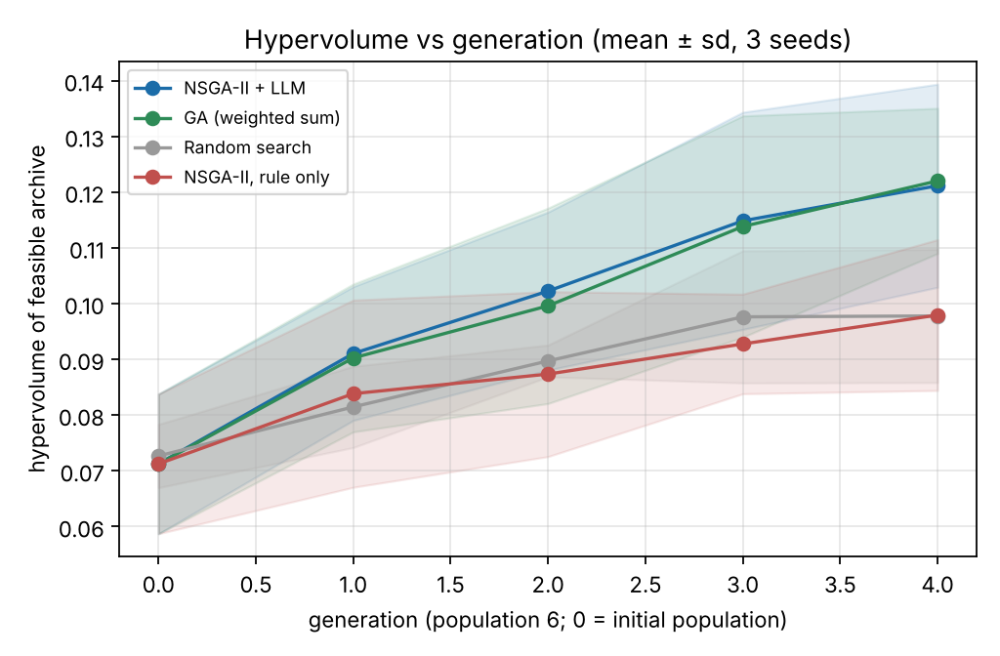
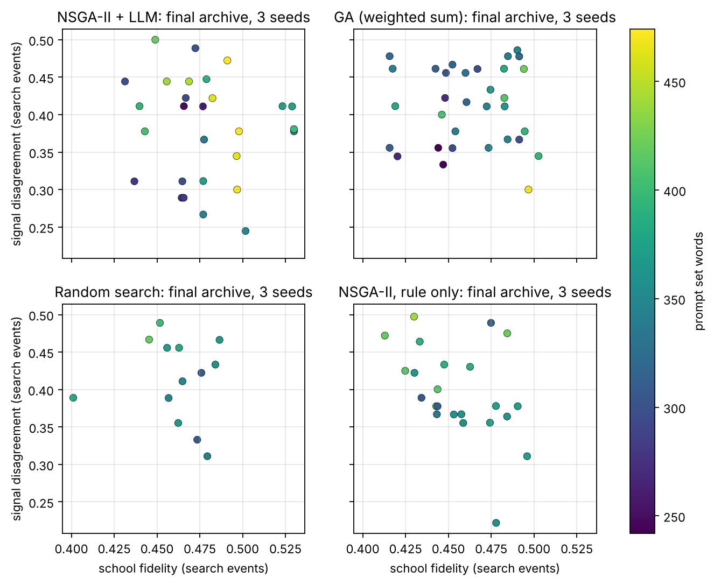
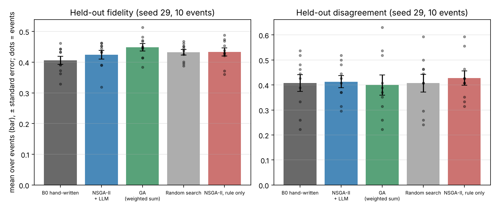

# Abstract

Multi-perspective LLM agents are useful only if each agent stays faithful to its perspective and the agents differ from one another. Prompt-optimisation work usually tunes one prompt against one score, so the trade-off between fidelity, mutual distinctness and prompt length is not searched directly. We cast the design of three economic-school agents (Keynesian, Austrian, Monetarist) as a constrained multi-objective problem over a *set* of prompts, search it with NSGA-II, and propose an LLM mutation that turns the parent's weakest objective into a rewrite instruction. On the main model (`qwen3.8-max`, population 6, four generations, three seeds), a complete ablation shows that the selection scheme makes no difference at this budget and that the guidance carries the gain: guided LLM mutation reaches a hypervolume of about 0.12 against about 0.10 for rule mutation and for LLM rewriting without objective information, and beats both in every seed. A replication of every arm on Claude Haiku 5.5 with five seeds points the same way in four of five seeds, less clearly because a length rule tuned to the first model rejected half of its edits. Against the published EvoPrompt-GA, the verbatim operator fails in this length- and format-constrained problem, and a length-bounded variant, added after that result, stays behind the guided method in all five seeds (one-sided p = 0.031). On held-out events no method beats the hand-written prompts after Holm correction on either model, and random search gains about as much fidelity as evolution; the searched sets are 20–30% shorter at similar fidelity and disagreement. All protocols, raw model outputs (13,121 calls, about USD 33 in total) and analysis code are released.

**Keywords:** evolutionary prompt optimisation, multi-objective evolutionary algorithms, NSGA-II, LLM-guided mutation, multi-agent diversity, quality-diversity.

# 1 Introduction

## 1.1 Problem and motivation

Systems that combine several LLM agents, each speaking from a different perspective, are increasingly used for analysis, forecasting and debate [@Baltaji2024persona; @Takano2025hawkish]. Their value rests on two properties that pull in opposite directions. Each agent must stay *faithful* to its perspective, and the agents must be *distinct* from one another, or the ensemble collapses into one voice. Recent evidence points to exactly this failure: debate and ensemble systems lose diversity through conformity and majority pressure [@Wu2025debate; @Zhu2026demystifying], and aligned models produce homogeneous outputs across many open-ended queries [@Jiang2025hivemind]. Prompts are the cheapest lever for setting perspective, but they are usually written by hand.

Evolutionary prompt optimisation can search prompts automatically, with an LLM supplying the variation operators [@Fernando2024promptbreeder; @Guo2024evoprompt; @Lange2024large]. These methods, however, optimise one prompt against one scalar score. None of them evolves a *set* of prompts whose members must be good individually and different from each other, and none exposes the trade-off between fidelity, distinctness and cost (prompt length). Multi-objective prompt search has started to appear [@Zhao2025pareto; @Camara2025moprompt]. We found no such work for multi-agent sets.

A preliminary, unpublished result from the author's MPhil project, whose harness this project borrows for its measurements, points the same way. In a 240-request disagreement matrix over six economic frameworks (synthetic events, generator seed 11, the same model identifier `qwen3.8-max`), the three trained schools disagreed about twice as much as one school disagreed with itself, while New Keynesian duplicated Keynesian within the noise floor. This evidence is used here only as motivation; none of its events or outputs enter the experiments below.

## 1.2 Research questions

- **RQ1.** Can NSGA-II over prompt sets, with LLM-guided mutation, find prompt sets that dominate a hand-written baseline and single-objective or random search in fidelity, inter-agent disagreement and length?
- **RQ2.** Which component carries the effect: the selection scheme, LLM mutation as such, or the objective-directed guidance of the LLM mutation?
- **RQ3.** Do the gains hold on unseen events?
- **RQ4.** How does the method compare with a published evolutionary prompt optimiser (EvoPrompt-GA), and do the findings hold on a second model from another provider?

## 1.3 Contributions

1. **Representation and objectives.** An individual is a set of three school genes (diagnosis, concepts, stance, contrast) decoded through the unchanged thesis prompt scaffold. Objectives are school fidelity, inter-school disagreement and prompt length, with Deb's constraint handling on output validity.
2. **Operators.** Structural crossover at school and field level; rule mutation that touches one school per child; and an LLM-guided mutation in which the parent's weakest objective is turned into a rewrite instruction (AI-to-EC).
3. **Evaluation design.** A complete 2 × 2 ablation (selection × mutation), a control in which the LLM rewrites without objective information, a published baseline (EvoPrompt-GA), and a replication of every arm on a second model (Claude Haiku 5.5, five seeds).
4. **Protocol.** A written analysis protocol and three addenda, each committed before the runs it governs (Section 4.8), held-out events from a separate seed, exact sign-flip tests with Holm correction, and a fully cached pipeline that can be re-run offline from the committed raw outputs.

# 2 Related Work

We collected 34 papers from 2024–2026 (`report/references.bib`). Every author list and first-submission date was checked against its arXiv page, and the journal DOIs, volumes and pages against the publisher records in Crossref. The papers are grouped by theme; the classic Promptbreeder and EvoPrompt papers are included because their venue versions are from 2024. The synthesis below is organised by method, not by paper.

## 2.1 LLMs as evolutionary variation operators

The strongest current trend treats an LLM as the mutation and crossover operator of an evolutionary loop. Promptbreeder evolves task prompts and the mutation prompts themselves [@Fernando2024promptbreeder]; EvoPrompt connects LLM-generated crossover and mutation with GA and DE on discrete prompts [@Guo2024evoprompt]; EvoLLM treats an LLM as an in-context recombination step for evolution strategies [@Lange2024large]. Beyond prompts, LLMs design heuristics and algorithms: EoH co-evolves natural-language thoughts with code [@Liu2024evolution], ReEvo adds reflective, verbal feedback to crossover and mutation [@Ye2024reevo], LLaMEA generates metaheuristics that beat CMA-ES on BBOB [@vanStein2024llamea], and Eureka evolves reward code from simulator feedback [@Ma2024eureka]. Automated design of agentic systems applies the same idea to whole agents, with an archive rather than a selection population [@Hu2025automated]. Surveys place these methods in a common frame, with the LLM as optimiser, predictor, extractor or designer [@Wu2025evolutionary; @Liu2026systematic]. Recent work also adds guidance on which parent and which operator to call, to save model calls [@Wang2026how].

**Gap.** Nearly all of this work optimises a single fitness value. Where diversity appears, it is an exploration device inside one search, not an objective.

## 2.2 Multi-objective and quality-diversity search with LLMs

Pareto-based prompt search is emerging. Pareto Prompt Optimization trains a prompt generator with dominance-based preference losses instead of a fixed scalarisation [@Zhao2025pareto]. MOPrompt runs a multi-objective evolutionary search on accuracy versus context length and reports a 31% shorter prompt at the best baseline's accuracy on one sentiment task [@Camara2025moprompt]. REMoH wraps NSGA-II around LLM-generated heuristics, with a clustering reflection step that keeps offspring diverse [@Fornies2025remoh]; an LLM-aided MOEA uses an LLM only when a surrogate says it is worth the call [@Liu2024llm]. On the quality-diversity side, LLMs can propose archive members in context [@Lim2024incontext], MAP-Elites explores prompt space by structural descriptors [@Santos2025diverse], and CycleQD cycles which objective acts as the quality measure while the others act as behaviour axes [@Kuroki2025cycleqd].

**Gap.** Multi-objective LLM search so far targets accuracy versus cost on one task. None uses a *between-agent* distinctness objective, and none evaluates a prompt set on held-out events.

## 2.3 Diversity and perspective fidelity in multi-agent LLM systems

Multi-agent discussion can increase viewpoint diversity, but conformity and confabulation erode it. Persona-assigned agents drift from their assigned views under debate instructions [@Baltaji2024persona]. Vanilla debate often underperforms majority vote, and explicitly diversifying the initial viewpoints and calibrating confidence helps [@Zhu2026demystifying]. In a controlled logic study, group diversity and reasoning strength mattered most, while majority pressure discouraged independent correction [@Wu2025debate]. Diversity collapses across models, not only within one: an open-ended study finds intra-model repetition and inter-model homogeneity [@Jiang2025hivemind]. For economic reasoning, LLMs lean towards intervention-oriented causal conclusions, and that bias persists under one-shot prompting [@Lee2026ideological]. Macro agents with explicit hawkish and dovish beliefs can improve FOMC classification, but the study does not check whether agents stay faithful to their belief across rounds [@Takano2025hawkish]. Survey simulations with LLM agents match macro expectation distributions only when priors are injected [@Lin2025simulating].

Automated multi-agent design is also active. MASS optimises prompts and topology in three stages with a single task score [@Zhou2026mass]. EvoMAS evolves multi-agent configurations by mutation and crossover guided by execution traces [@Hu2026evomas].

**Gap.** Diversity is studied as an accuracy device or as a property to be measured, but not as an optimisation target next to persona fidelity, and not for competing economic perspectives.

## 2.4 Evolutionary model merging, fine-tuning and self-evolution

This family is on the course's list of directions and is the closest population-based alternative to our method that changes model weights instead of prompt text. We review it briefly to show where our setting sits.

Evolution has been applied to parameters and recipes rather than text. Evolutionary search over merge recipes, in parameter and data-flow space, yields state-of-the-art Japanese models [@Akiba2025merging]. Multi-objective evolution of merged experts trades cross-task performance against storage [@Qiu2026modular], and a two-dimensional recombination of LLM blocks is searched by bi-level multi-objective evolution [@Wu2026lego]. Layer-wise merging of reasoning-tuned LLMs is another route to combining specialised models [@Zhang2024unconstrained]. Evolution strategies can fine-tune billion-parameter LLMs without gradients [@Qiu2026es], and black-box evolutionary merging works from API queries alone [@Chen2025evomerging]. Self-evolving training co-evolves a rubric generator and a policy without human labels [@Li2026evolm].

**Gap.** These methods optimise weights, which requires training or merging infrastructure. The project's setting, where the only decision variables are the texts of a few prompts, is a cheaper and more interpretable point in the same family.

## 2.5 Synthesis and positioning

Table 1 summarises the literature along the axes that matter for this project.

| Axis | Typical finding | Relevance to our design |
|---|---|---|
| LLM as operator | Works for prompts, heuristics and code [@Fernando2024promptbreeder; @Guo2024evoprompt; @Liu2024evolution] | We use an LLM mutation with an objective-directed instruction |
| Objective | Mostly one scalar; Pareto variants exist for accuracy versus cost [@Zhao2025pareto; @Camara2025moprompt] | Three objectives, one of which is inter-agent distinctness |
| Diversity | Measured or used as initialisation; homogeneity documented [@Jiang2025hivemind; @Zhu2026demystifying] | Made an explicit objective |
| Persona fidelity | Erodes under debate [@Baltaji2024persona; @Wu2025debate] | Measured with a lexicon; held out on separate events |
| Evaluation | Mostly one task; few held-out checks | Search and held-out seeds are separate; ablations are reported |

**Our position.** To our knowledge no paper combines (i) a *set* of agent prompts as one individual, (ii) a between-agent distinctness objective next to fidelity and length, (iii) an LLM as the mutation operator guided by the weakest objective, and (iv) a held-out check on unseen events. We treat the position as a gap identified from this review rather than as a proof of novelty.

# 3 Method

## 3.1 Problem formulation

An individual is a prompt set $P = (g_{\text{kw}}, g_{\text{au}}, g_{\text{mo}})$ with one gene per school. For a set of synthetic events $E$, each school $s$ answers each event with a parseable report or fails. Three objectives are minimised, all in $[0,1]$:

- $g_1 = 1 - \text{fidelity}(P)$, where fidelity is the mean lexicon consistency of each school's answers (the thesis consistency score, $C_s$).
- $g_2 = 1 - \text{disagreement}(P)$, where disagreement is the mean pairwise signal disagreement between the three schools (`mosaic.divergence.distance`).
- $g_3 = \min(1, \text{words}(P)/600)$.

Feasibility requires that at least 90% of school outputs are parseable. Infeasible sets are ranked by their violation, following Deb's rule.

## 3.2 Genome and decoding

Each school gene has four parts: `diagnosis` (sentences), `concepts` (an ordered subset of a concept pool), `stance` (sentences describing typical readings of events) and an optional `contrast` (sentences of the form "unlike the other schools, you ..."). Decoding fills the unchanged `mosaic.divergence.messages()` template, so the output format (causal chain, scenarios, signals) and the events are identical to the thesis harness. The initial population is the hand-written set B0 plus perturbed copies of it.

## 3.3 Variation

- **Structural crossover** (probability 0.7). With probability 0.5 whole school genes are swapped between parents; otherwise each field of each school is picked from one parent.
- **Rule mutation.** One school is chosen; one or two of: drop or swap a diagnosis sentence, drop, add or reorder a concept. It changes one school, so the other two school outputs are reused from the cache. No rule operator adds a diagnosis sentence or touches `stance` and `contrast`, so rule mutation can only keep or reduce the length of the text it edits (adding a concept adds a few words). This bias towards shorter sets matters when reading the length results (Section 5.2).
- **LLM-guided mutation** (probability 0.5 of the mutations in the LLM methods). The parent's evaluation picks the objective to improve, with probability proportional to its badness: fidelity (rewrite the least faithful school's diagnosis using its lexicon terms), distinctness (rewrite one field of one of the two most similar schools so that it makes different calls from the other), or length (shorten the longest school's diagnosis to 40 words). The model returns one paragraph; it is accepted if it has 5 to 120 words, and otherwise the child falls back to rule mutation (on qwen, summed over the three seeds, 8 of 30 LLM children in NSGA-II and 10 of 34 in the GA were rejected this way; on Haiku about half, Section 5.3).

## 3.4 Selection

- **NSGA-II.** Constrained non-dominated sorting, crowding distance, binary tournament on (rank, crowding), and elitist $(\mu+\lambda)$ environmental selection [@Deb2002].
- **GA (B2).** The same operators, but selection by feasibility first and then the equal-weight sum of $g_1, g_2, g_3$. This isolates the effect of the selection scheme.

## 3.5 Baselines, ablation and indicator

- **B0.** The hand-written profiles, evaluated with three independent sampling seeds.
- **B1 random search.** Independent random rule perturbations of B0 (1 to 3 operators per school), the same number of evaluations, and the same archive.
- **Ablations.** NSGA-II with rule mutation only, and the GA with rule mutation only; with the two LLM arms they form a 2 × 2 design (selection × mutation).
- **Unguided LLM control.** NSGA-II with an LLM mutation that carries no objective information: the same call, share and acceptance rule as the guided operator, but the school and the field (diagnosis or stance) are drawn at random and the instruction is fixed: "Rewrite this paragraph in your own words. Keep its meaning and keep it as one paragraph." It separates the guidance from LLM rewriting as such.
- **Published baseline: EvoPrompt (GA)** [@Guo2024evoprompt]. Parents are chosen by roulette wheel on the score $1 - \bar g$; one LLM call per school and child applies the paper's crossover-and-mutation template (verbatim, Figure 1 of the paper) to the two parents' diagnosis paragraphs, and the best $N$ of parents and children survive. Four adaptations were needed and are stated as such: the operator is applied to each of the three schools (the paper evolves one prompt); the answer inside `<prompt>` brackets is accepted if it has 5 to 600 words (the paper's operator writes whole prompts, see Section 4.8); the final solution is the shared knee, not EvoPrompt's argmax; and the initial population is the shared one (B0 plus perturbed copies), as the paper also starts from manual prompts.
- **Indicator.** Exact 3-D hypervolume of the feasible non-dominated archive, with reference point (1, 1, 1). The archive keeps every feasible set evaluated, so all methods are compared on the same footing.
- **Knee.** The archive member closest to the ideal point (0, 0, 0). The rule was fixed in `code/PROTOCOL.md` before the held-out analysis. The objectives are not rescaled. Across the final fronts $g_3$ spans about 0.40 to 0.79 and $g_2$ about 0.50 to 0.78, but $g_1$ only about 0.47 to 0.60, so fidelity carries the least weight in the distance and the knee tends to be one of the shorter feasible sets.

# 4 Experimental Setup

## 4.1 Task and data

The task is a set of synthetic macroeconomic events produced by `mosaic.teacher.make_items`. The search set is the first five events of seed 23 and the held-out set is the first ten of seed 29; one held-out event (`syn-k0007`, seed 29) has the same text as one search event (`syn-k0002`, seed 23), although the two have different macro contexts. Section 5.2 reports the held-out tests with that event removed. Seed 11 (the thesis disagreement matrix) and all thesis held-out files are not used. Lexicons come from `configs/lexicons.toml`, which the thesis marks as PROVISIONAL; this affects the fidelity objective (Section 6).

## 4.2 Model and backend

**Main model.** Each call goes to an OpenAI-compatible endpoint (`qwen3.8-max`, the model used for the thesis disagreement matrix) with temperature 0.7, top-p 0.9, at most 1,024 output tokens, thinking disabled and a per-run sampling seed. Every response is stored in an append-only cache keyed by the model, the messages and the sampling parameters (`results/cache/llm_cache.jsonl`). A ledger records token counts and an estimated spend under a cap per command. The spend uses assumed list prices of USD 2.4 and 9.6 per million input and output tokens; the measured token counts are stored, so the cost can be recomputed with the provider's sheet.

**Second model.** The replication uses `claude-haiku-5-5` through the official Anthropic SDK. The model rejects non-default temperature and top-p, so its default sampling is used; thinking is disabled and the output limit is 1,024 tokens, as for qwen. The API has no sampling seed, so the seed is kept in the cache key (each seed draws its own samples) but not sent. Everything for this model is stored under `results/haiku/` with its own cache; its ledger uses the list prices of USD 0.10 and 0.50 per million tokens.

## 4.3 Hyperparameters

| Parameter | Value |
|---|---|
| Population $N$ | 6 |
| Generations $G$ | 4 (so $N(G+1) = 30$ evaluations per run) |
| Search events / held-out events | 5 / 10 |
| Algorithm seeds (paired across methods) | 1, 2, 3 (qwen); 1 to 5 (Haiku) |
| Crossover / mutation / LLM share | 0.7 / 0.9 / 0.5 |
| Tournament size | 2 |
| Feasibility threshold | 0.9 |
| Length normalisation | 600 words |
| Hypervolume reference | (1, 1, 1) |
| LLM edit length | 5 to 120 words (guided and unguided edits); 5 to 600 words (EvoPrompt answers) |
| Sampling | qwen: temperature 0.7, top-p 0.9; Haiku: provider default; both max 1,024 tokens, thinking off |

## 4.4 Procedure

1. For each method and seed, run the search on the five search events and keep the archive (`results/runs/<method>_s<seed>/gen_log.csv`, `evaluations.jsonl`, `front.jsonl`).
2. Select the knee of the final archive and write it to `results/best_prompts/`.
3. Re-measure each knee, and B0, on the ten held-out events. Each knee is also re-scored from the cache per event (`results/heldout_per_event.csv`).
4. Average over seeds per event and test each method against B0 with an exact paired sign-flip test over the ten events, with Holm over the method-versus-B0 tests of that model (`results/heldout_tests.csv`); the protocol family adds every method-versus-method test (`results/heldout_tests_protocol.csv`).

## 4.5 Statistics

Search-level results are mean ± sample standard deviation over three seeds. Held-out intervals are 95% percentile bootstrap intervals over the ten events (10,000 resamples, `mosaic.stats.paired`, seed 0). They are not corrected for multiple comparisons; the p-values are exact sign-flip values and are the ones corrected with Holm. With three paired seeds the smallest attainable one-sided sign-flip p-value is 1/8, so qwen search-level comparisons are reported descriptively, with the per-seed differences; with five seeds (Haiku) it is 1/32, and the exact one-sided value is reported. The inferential test uses the ten held-out events, where the smallest attainable two-sided p-value is 2/1024.

## 4.6 Reproduction

`code/README.md` gives the commands. The qwen matrix was run with `python -m evo_prompt.runner --methods b0 nsga2 ga random nsga2_rule --seeds 1 2 3 --gens 4 --pop 6 --heldout --budget 30`, the two ablation arms with `--methods ga_rule nsga2_llmu` and the same settings, and the Haiku replication with `--profile haiku` and seeds 1 to 5 (the exact commands are in the protocol addenda). The tables come from `python -m evo_prompt.analyze` (add `--profile haiku` for the replication) and the figures from `python -m evo_prompt.figures`. The analysis reads only the committed cache, so it makes no model calls.

## 4.7 Computing environment and measured performance

**Hardware.** The search and the analysis ran on a CPU-only Linux machine (x86_64, no GPU). The language model was accessed over HTTPS through an OpenAI-compatible chat endpoint, so the model's hardware is outside our control.

**Software.** Python 3.13.18; numpy 2.5.3 (analysis), matplotlib 3.11.2 (figures), pytest 9.2.0 (tests). The qwen client uses only the Python standard library; the Haiku client uses the official `anthropic` SDK 2.3.0. The versions are those of the environment in which the reported runs were made; no lock file is provided.

**Concurrency.** On qwen each batch of model calls sends up to 16 requests in parallel; on Haiku up to 8, and from the parallel phase on (Section 4.8) up to 6 per process with up to 7 processes. Every response is written to the cache before the next batch starts.

**Measured performance.** The figures below come from the caches, which store the response time and token counts of every call.

- qwen, recorded calls: 3,709, of which 2,743 belong to the main matrix, 106 to the API smoke test, 675 to the two ablation arms and 185 to the incomplete EvoPrompt run.
- qwen, per-call latency: median 14.9 s, mean 15.0 s, 90th percentile 17.3 s, maximum 183.9 s; token totals 2,510,128 input and 2,217,418 output.
- Haiku, recorded calls: 9,412 (the smoke test of addendum B is not included); per-call latency median 5.6 s, mean 5.7 s, 90th percentile 7.0 s, maximum 10.0 s; token totals 9,261,362 input and 8,710,072 output; summed latency about 14.9 hours.
- Summing the qwen per-call latencies gives about 15.4 hours. This is not wall-clock time, because requests ran in parallel. Wall-clock durations were not logged.
- The 27 offline tests run in about one second.

## 4.8 Protocol, addenda and deviations

The analysis follows `code/PROTOCOL.md` and four addenda. Each addendum was committed before the first model call of the runs it governs; the commit times (UTC, 2026-11-02) are in the git history.

| Document | Commit | Governs |
|---|---|---|
| `PROTOCOL.md` | `b3cfd5e` (2026-11-01) | main qwen matrix (B0, NSGA-II + LLM, GA, random search, NSGA-II rule only) |
| Addendum A | `78cb5a1` (04:19) | GA rule only and NSGA-II + unguided LLM on qwen; questions Q1 to Q3 and their decision rule |
| Addendum B | `c58798a` (04:29) | Haiku replication of every arm, seeds 1 to 5 |
| Addendum C | `507545a` (04:37) | EvoPrompt-GA baseline; parallel execution of the Haiku runs |
| Addendum D | `f5e935e` (05:00) | length-bounded EvoPrompt variant on Haiku (post hoc, see item 7) |

The analysis departs from these documents, or from their wording, in the following places.

1. **Timing of the main protocol.** `PROTOCOL.md` states that it was written before any full-matrix result existed. In fact it was committed (2026-11-01, 15:12 UTC) while the matrix was running, together with a snapshot that already held the seed-1 knee prompt sets of NSGA-II, the GA and random search. The runner measures each knee on the held-out events at the end of its run, so some seed-1 held-out values may have existed at that time. The held-out tables, tests and figures were produced afterwards. The main protocol was therefore fixed before the held-out *analysis*, not before every result; we do not call it a pre-registration. The addenda do not have this problem.
2. **Test family.** The protocol applies Holm across method-versus-B0 *and* method-versus-method comparisons. Tables 3 and 4 use the method-versus-B0 tests only (12 tests for qwen). The full family (12 + 30 = 42 tests for qwen, 16 + 56 = 72 for Haiku) is in `results/heldout_tests_protocol.csv` and its Haiku counterpart; the smallest Holm-adjusted p-value is 1.0 for qwen and 0.425 for Haiku, so no conclusion changes.
3. **Post-hoc sensitivity analysis.** Removing the held-out event whose text duplicates a search event (Section 5.2) was not in the protocol. It was added after the overlap was found.
4. **EvoPrompt acceptance rule (amendment to addendum C).** Addendum C first applied the 5-to-120-word rule of our edit operator to EvoPrompt's answers. All 18 first-generation answers on qwen had 143 to 370 words, so every one was rejected and the baseline would have run without variation. Before any fitness comparison, the rule was changed for this arm to 5 to 600 words (`187dc01`, 04:38); long answers are penalised by the length objective instead of being discarded. The stopped first run had already written its seed-1 search files; they were moved out of `results/` without being read.
5. **qwen EvoPrompt incomplete.** The qwen quota ran out during generation 2 of seed 1 of the restarted EvoPrompt run. As addendum C requires, the arm is reported as incomplete and left out of every qwen table; the comparison with the published baseline is made on Haiku only.
6. **Parallel execution on Haiku.** For speed, the sequential Haiku run was stopped after B0 and NSGA-II seeds 1 to 3, its cache was frozen as a read-only base, and the remaining arms (later also individual seeds of the two slowest arms) ran in separate processes with their own cache layers. Arms therefore do not share samples drawn after the freeze, so the Haiku trajectories of, for example, NSGA-II and the GA are less coupled than on qwen. This changes only execution, not the design. It also means that the initial populations of seeds 4 and 5 were sampled separately per arm, so generation-0 hypervolumes differ slightly between Haiku arms (Figure 4).
7. **Post-hoc variant.** Addendum D was written after the Haiku EvoPrompt result had been seen and analysed. It adds the smallest change that lets that baseline work in this problem; the verbatim baseline is reported as well, and the variant is labelled as post hoc wherever it appears.

# 5 Results and Analysis

## 5.1 Main model: search level

Table 2 reports the archive and the knee on the search events for the six qwen arms. Values are mean ± sd over three seeds (`results/summary_table.md`).

| Method | Hypervolume | Front size | Knee fidelity | Knee disagreement | Knee validity | Knee words |
|---|---|---|---|---|---|---|
| NSGA-II + LLM | 0.1211 ± 0.0182 | 9.3 ± 1.5 | 0.461 ± 0.026 | 0.460 ± 0.025 | 0.978 ± 0.039 | 330 ± 50 |
| GA (weighted sum) | 0.1220 ± 0.0130 | 10.7 ± 1.2 | 0.452 ± 0.038 | 0.459 ± 0.032 | 1.000 ± 0.000 | 305 ± 29 |
| Random search | 0.0978 ± 0.0119 | 4.3 ± 0.6 | 0.474 ± 0.011 | 0.437 ± 0.017 | 1.000 ± 0.000 | 350 ± 38 |
| NSGA-II, rule only | 0.0979 ± 0.0135 | 7.7 ± 4.0 | 0.460 ± 0.016 | 0.429 ± 0.061 | 0.933 ± 0.000 | 346 ± 37 |
| GA, rule only | 0.0985 ± 0.0201 | 7.7 ± 2.1 | 0.456 ± 0.032 | 0.463 ± 0.026 | 0.933 ± 0.000 | 356 ± 52 |
| NSGA-II + unguided LLM | 0.1022 ± 0.0320 | 9.7 ± 2.9 | 0.459 ± 0.027 | 0.418 ± 0.013 | 1.000 ± 0.000 | 338 ± 71 |

Figure 1 shows the mean hypervolume per generation. Generation 0 is the shared initial population (0.071 for every arm except random search, 0.073). The two arms with guided LLM mutation rise above the others from generation 1 on and end at 0.121 and 0.122; the three rule-based arms and the unguided control end between 0.098 and 0.102.

Table 2b arranges the final hypervolume as the 2 × 2 design of selection and mutation, with the unguided control alongside.

| Selection | Rule mutation only | Guided LLM mutation | Unguided LLM mutation |
|---|---|---|---|
| GA (weighted sum) | 0.0985 | 0.1220 | not run |
| NSGA-II | 0.0979 | 0.1211 | 0.1022 |

Addendum A fixed three questions and a decision rule before the two new arms were run: a direction counts as consistent only if all three paired seeds agree in sign (one-sided sign-flip p = 1/8, the smallest value three seeds allow).

| Question | Comparison | Seed 1 | Seed 2 | Seed 3 | Mean | Consistent |
|---|---|---|---|---|---|---|
| Q1 selection, rule mutation | GA rule − NSGA-II rule | −0.0019 | −0.0049 | +0.0085 | +0.0006 | no |
| Q2 LLM mutation, GA selection | GA − GA rule | +0.0235 | +0.0463 | +0.0007 | +0.0235 | yes |
| Q3 guidance | NSGA-II + LLM − NSGA-II + unguided LLM | +0.0327 | +0.0212 | +0.0029 | +0.0189 | yes |

The answer to RQ2 on qwen is now direct.

- **Selection does not matter here.** With rule mutation the two selection schemes reach the same hypervolume and disagree in sign across seeds (Q1); with guided LLM mutation they also end level (0.1211 against 0.1220). Four generations of population 6 leave little room for the schemes to differ, so this is a statement about this budget.
- **LLM mutation helps under both selection schemes.** Under GA selection it raises the hypervolume in all three seeds (Q2), and under NSGA-II the same holds against the rule-only ablation (0.114 against 0.087, 0.108 against 0.093, 0.142 against 0.113).
- **The guidance is what helps, not LLM rewriting as such.** The unguided control ends at 0.102, close to the rule-only arms, and the guided operator beats it in all three seeds (Q3). This is the most direct evidence for the operator proposed in Section 3.3.
- **Strength.** All three statements rest on three paired seeds. The seed-3 differences of Q2 and Q3 are small (+0.0007 and +0.0029), and random search with seed 2 (0.112) ends above NSGA-II + LLM with seed 2 (0.108). Section 5.3 repeats the questions on a second model with five seeds.

Figure 2 shows where the extra hypervolume comes from. The arms with LLM mutation reach the shortest sets (242 to 256 words); every rule-based arm stays at 292 words or more. The guided NSGA-II archive also reaches the highest fidelity (0.53), while the unguided control does not exceed 0.496.

## 5.2 Main model: held-out events

Table 3 reports the knee solutions on the ten held-out events. The ± values are not of the same kind: for B0 they are the spread over three sampling seeds of one fixed prompt set, and for the search methods they are the spread over three algorithm seeds, each of which produces a different knee prompt set (and is evaluated with its own sampling seed). The second includes the first.

| Method | Fidelity | Disagreement | Validity | Words |
|---|---|---|---|---|
| B0 hand-written | 0.406 ± 0.002 | 0.407 ± 0.028 | 0.989 ± 0.019 | 438 |
| NSGA-II + LLM | 0.424 ± 0.017 | 0.423 ± 0.006 | 0.989 ± 0.019 | 330 ± 50 |
| GA (weighted sum) | 0.448 ± 0.043 | 0.419 ± 0.027 | 0.978 ± 0.019 | 305 ± 29 |
| Random search | 0.432 ± 0.009 | 0.432 ± 0.024 | 0.967 ± 0.033 | 350 ± 38 |
| NSGA-II, rule only | 0.433 ± 0.032 | 0.428 ± 0.048 | 1.000 ± 0.000 | 346 ± 37 |
| GA, rule only | 0.433 ± 0.006 | 0.415 ± 0.075 | 1.000 ± 0.000 | 356 ± 52 |
| NSGA-II + unguided LLM | 0.441 ± 0.017 | 0.372 ± 0.037 | 1.000 ± 0.000 | 338 ± 71 |

Table 4 gives the paired tests. Each comparison uses the ten held-out events, and Holm correction covers the twelve method-versus-B0 tests.

| Comparison | Metric | Mean difference (method − B0) | 95% bootstrap CI | p (exact, raw) | p (Holm) |
|---|---|---|---|---|---|
| NSGA-II + LLM − B0 | fidelity | +0.0179 | [-0.0086, +0.0413] | 0.2168 | 1.0000 |
| NSGA-II + LLM − B0 | disagreement | +0.0056 | [-0.0649, +0.0725] | 0.8672 | 1.0000 |
| GA (weighted sum) − B0 | fidelity | +0.0426 | [+0.0133, +0.0734] | 0.0293 | 0.3223 |
| GA (weighted sum) − B0 | disagreement | -0.0074 | [-0.0889, +0.0704] | 0.8848 | 1.0000 |
| Random search − B0 | fidelity | +0.0262 | [+0.0084, +0.0437] | 0.0254 | 0.3047 |
| Random search − B0 | disagreement | +0.0000 | [-0.0813, +0.0741] | 0.9805 | 1.0000 |
| NSGA-II, rule only − B0 | fidelity | +0.0272 | [+0.0041, +0.0503] | 0.0566 | 0.4531 |
| NSGA-II, rule only − B0 | disagreement | +0.0204 | [-0.0518, +0.0852] | 0.5664 | 1.0000 |
| GA, rule only − B0 | fidelity | +0.0275 | [+0.0053, +0.0475] | 0.0410 | 0.4102 |
| GA, rule only − B0 | disagreement | +0.0075 | [-0.0610, +0.0704] | 0.8086 | 1.0000 |
| NSGA-II + unguided LLM − B0 | fidelity | +0.0354 | [+0.0080, +0.0632] | 0.0488 | 0.4395 |
| NSGA-II + unguided LLM − B0 | disagreement | -0.0351 | [-0.0907, +0.0278] | 0.3242 | 1.0000 |

No comparison is significant after Holm correction (smallest adjusted p = 0.305). Before correction, the exact sign-flip p-values of the fidelity gains of the GA, random search, the GA with rule mutation and the unguided control lie between 0.025 and 0.049, and their uncorrected bootstrap intervals exclude zero; none survives the correction across twelve tests, and none survives in the 42-test protocol family (Section 4.8). We therefore read these fidelity gains as suggestive, not established. Removing the one held-out event whose text duplicates a search event (Section 4.1), the exact sign-flip p-values on the remaining nine events are 0.059 for the GA fidelity gain, 0.051 for random search, 0.109 for NSGA-II with rule mutation, 0.066 for the GA with rule mutation and 0.082 for the unguided control, and no conclusion changes.

Four observations follow from the tables.

1. **The prompt sets get shorter, not less faithful.** The searched knees have 305 to 356 words against 438 for B0 (about 20% to 30% shorter), with fidelity and disagreement within a few hundredths of B0. Much of this is built into the design rather than found by the search: rule mutation can only shorten the diagnosis (Section 3.3), and the knee rule weights length more than fidelity (Section 3.5). Random search, which uses only rule mutation and the same knee rule, also ends 20% shorter. The length gain is real for a deployment that pays per token, but it is not evidence that evolution works.
2. **The search-level advantage of guided LLM mutation does not carry over to held-out fidelity.** Random search gains more fidelity (+0.026) than NSGA-II with guided LLM mutation (+0.018), and the rule-only arms and the unguided control gain +0.027 to +0.035. Random search has no selection *during* the search, but its knee is still the best of 30 sets on the search events by the knee rule, so it is a best-of-30 selection. Held-out fidelity gains are therefore better read as an effect of choosing a prompt set on the search events at all than as an effect of any particular operator. Only the GA's gain (+0.043) is larger, and it is not significant after correction. This is the main caution for the conclusions in Section 6.
3. **Disagreement hardly moves.** B0's own three sampling replicates, with the prompt set held fixed, range from 0.406 to 0.433 on the held-out events. Every search arm stays within 0.021 of B0 except the unguided control, whose knees lose 0.035 (0.372); its raw p-value is 0.32. That unguided rewriting may make the schools sound more alike is consistent with Section 2.3, but this experiment cannot establish it.
4. **Search-level rankings do not carry over.** On the search events random search has the highest knee fidelity (0.474) and the GA the lowest (0.452); on the held-out events the order of these two is reversed (0.432 against 0.448). With five search events, the knee choice is driven partly by noise, which limits what the search-level comparison in Section 5.1 can say about generalisation.

## 5.3 Second model (Claude Haiku 5.5) and the published baseline

Every arm was re-run on Claude Haiku 5.5 with five seeds (addendum B), together with the published EvoPrompt-GA baseline (addendum C) and, after its result was seen, a length-bounded variant of it (addendum D). Table 5 gives the search-level results (`results/haiku/summary_table.md`).

| Method | Hypervolume | Front size | Knee fidelity | Knee disagreement | Knee words |
|---|---|---|---|---|---|
| NSGA-II + LLM | 0.0744 ± 0.0096 | 7.0 ± 3.6 | 0.283 ± 0.011 | 0.471 ± 0.045 | 323 ± 33 |
| GA (weighted sum) | 0.0721 ± 0.0136 | 7.2 ± 1.9 | 0.263 ± 0.016 | 0.510 ± 0.058 | 330 ± 30 |
| Random search | 0.0664 ± 0.0052 | 5.8 ± 2.2 | 0.299 ± 0.008 | 0.455 ± 0.027 | 345 ± 26 |
| NSGA-II, rule only | 0.0675 ± 0.0145 | 7.8 ± 3.1 | 0.276 ± 0.040 | 0.491 ± 0.058 | 344 ± 24 |
| GA, rule only | 0.0677 ± 0.0107 | 7.2 ± 3.6 | 0.267 ± 0.033 | 0.509 ± 0.064 | 343 ± 19 |
| NSGA-II + unguided LLM | 0.0606 ± 0.0146 | 5.2 ± 1.9 | 0.290 ± 0.013 | 0.457 ± 0.071 | 368 ± 44 |
| EvoPrompt (GA) | 0.0444 ± 0.0099 | 3.0 ± 0.7 | 0.254 ± 0.020 | 0.456 ± 0.068 | 392 ± 28 |
| EvoPrompt (GA), length-bounded | 0.0491 ± 0.0085 | 6.2 ± 0.8 | 0.262 ± 0.020 | 0.483 ± 0.037 | 412 ± 45 |

The absolute fidelity is much lower than on qwen (0.25 to 0.30 against 0.45 to 0.47 on the search events): Haiku uses fewer of the lexicon terms, so fidelity values are not comparable across models, only within one. NSGA-II with guided LLM mutation again has the highest mean hypervolume. Table 5b repeats the questions of addendum A and adds the comparisons with the baseline; with five seeds the exact one-sided sign-flip p-value can reach 1/32 = 0.031.

| Question | Comparison | Seeds 1 to 5 | Mean | Consistent | p (one-sided) |
|---|---|---|---|---|---|
| Q1 selection, rule mutation | GA rule − NSGA-II rule | −0.007, +0.009, −0.003, +0.009, −0.007 | +0.000 | no | 0.500 |
| Q2 LLM mutation, GA selection | GA − GA rule | +0.018, +0.013, +0.010, −0.008, −0.011 | +0.004 | no | 0.250 |
| (Q2 under NSGA-II) | NSGA-II + LLM − NSGA-II rule | +0.012, +0.016, +0.005, +0.008, −0.006 | +0.007 | no | 0.094 |
| Q3 guidance | NSGA-II + LLM − NSGA-II + unguided LLM | +0.027, +0.013, −0.004, +0.000, +0.032 | +0.014 | no | 0.094 |
| Q4 published baseline | NSGA-II + LLM − EvoPrompt (GA) | +0.033, +0.024, +0.023, +0.024, +0.046 | +0.030 | yes | 0.031 |
| Q5 length-bounded baseline | NSGA-II + LLM − EvoPrompt (GA), length-bounded | +0.029, +0.023, +0.018, +0.013, +0.043 | +0.025 | yes | 0.031 |

What carries over from qwen, and what does not:

- **Selection still does not matter** (Q1, and NSGA-II + LLM against the GA: 0.0744 against 0.0721, mixed signs).
- **The LLM effects are weaker and no longer consistent.** Guided LLM mutation beats rule mutation in four of five seeds under NSGA-II and three of five under the GA, and beats the unguided control in four of five (Q3, p = 0.094). The direction agrees with qwen; the decision rule of addendum A (all seeds agree) is not met. One reason is visible in the logs: Haiku writes longer rewrites, so 28 of 60 guided edits in NSGA-II (47%) and 27 of 54 in the GA (50%) were rejected by the 120-word rule and fell back to rule mutation, against 27% and 29% on qwen and 6 of 48 (13%) for the unguided control. On Haiku the guided arms therefore ran with half of their LLM edits replaced by rule mutation.
- **The verbatim EvoPrompt baseline fails in this problem, and the comparison with it says little.** NSGA-II + LLM beats EvoPrompt-GA in all five seeds (Q4, p = 0.031), but the reason is not subtle. EvoPrompt's children had 668 to 1,132 words (initial population: median 420), every one saturated the length objective, and only 3 of 120 were feasible, because agent outputs to such long prompts were often cut off or unparseable. Its archive never improved on the initial population (hypervolume 0.044 in every generation). The paper's operator asks for "a better prompt" and has no notion of length or of the output format, which is exactly what this problem constrains.
- **The length-bounded variant works as an optimiser but stays behind.** With one sentence added to the template (addendum D, decided after the result above), EvoPrompt's children had 396 to 608 words (median 480), 60 of 120 were feasible, no answer was rejected, and the archive improved in every generation (from 0.044 to 0.049). NSGA-II + LLM still beats it in all five seeds (Q5, mean +0.025, p = 0.031). Its children stay longer than the initial sets, so the length objective and the format constraint still cost it: a general operator told only about length does worse than one that is told which of the three objectives to improve.

On the held-out events (Table 6, `results/haiku/heldout_tests.csv`) no method differs from B0 after Holm correction over the method-versus-B0 tests; the smallest adjusted p-value is that of the unguided control's fidelity gain (+0.023, raw p = 0.008, adjusted 0.125 over 16 tests), and in the 72-test protocol family the smallest is 0.425. Neither EvoPrompt arm differs from NSGA-II + LLM on held-out events after correction. The same arm also raises disagreement (+0.058, raw p = 0.027), the opposite of its effect on qwen (−0.035), so the effect of unguided rewriting on disagreement is not stable across models. B0's five sampling replicates span 0.446 to 0.540 in held-out disagreement, wider than on qwen.

Table 6 gives the held-out means on Haiku (mean ± sd over five seeds; B0 over five sampling replicates).

| Method | Fidelity | Disagreement | Validity | Words |
|---|---|---|---|---|
| B0 hand-written | 0.238 ± 0.018 | 0.427 ± 0.067 | 0.927 ± 0.043 | 438 |
| NSGA-II + LLM | 0.248 ± 0.027 | 0.481 ± 0.039 | 0.960 ± 0.028 | 323 ± 33 |
| GA (weighted sum) | 0.244 ± 0.034 | 0.459 ± 0.031 | 0.940 ± 0.049 | 330 ± 30 |
| Random search | 0.259 ± 0.023 | 0.488 ± 0.058 | 0.933 ± 0.033 | 345 ± 26 |
| NSGA-II, rule only | 0.243 ± 0.020 | 0.458 ± 0.044 | 0.973 ± 0.028 | 344 ± 24 |
| GA, rule only | 0.241 ± 0.050 | 0.506 ± 0.046 | 0.967 ± 0.033 | 343 ± 19 |
| NSGA-II + unguided LLM | 0.261 ± 0.019 | 0.518 ± 0.069 | 0.967 ± 0.024 | 368 ± 44 |
| EvoPrompt (GA) | 0.224 ± 0.005 | 0.495 ± 0.040 | 0.947 ± 0.018 | 392 ± 28 |
| EvoPrompt (GA), length-bounded | 0.243 ± 0.010 | 0.463 ± 0.088 | 0.940 ± 0.028 | 412 ± 45 |

## 5.4 Qualitative observations

The examples below are from qwen. Summed over three seeds, 8 of 30 LLM-guided children in NSGA-II (27%) and 10 of 34 in the GA (29%) were rejected by the 5-to-120-word check and replaced by rule mutation (`results/runs/*/evaluations.jsonl`, origin suffix `f`). Reading the accepted edits (the fields of LLM children that do not occur earlier in the same run) shows two kinds of rewrite, which match the length and fidelity instructions.

- **Compression.** Length-directed edits shorten a diagnosis to about 40 words and mostly keep its structure. In the NSGA-II seed-3 knee, the Keynesian diagnosis went from 130 to 40 words: "Assess the output gap via unemployment (natural ~4.5%) and inflation (2% target): negative gaps need support; positive gaps require restraint. Distinguish supply shocks' price versus income effects, noting which dominates. Evaluate policy using the real rate (policy rate minus inflation)." The definitions of the liquidity trap and the paradox of thrift, and the condition on a low policy rate, were dropped. Compression can also change the meaning. In the same run, the Monetarist sentence "a relative-price change becomes inflation only if money accommodates it" was shortened to "Money accommodates supply-shock inflation", which reverses a conditional into a claim. The lexicon-based objectives cannot detect such an error.
- **Lexicon loading.** Fidelity-directed edits rewrite a diagnosis around school vocabulary and grow it to 80 to 110 words. A typical Austrian rewrite (NSGA-II, seed 3) reads "Ask first whether the event alters time preference or initiates credit expansion, for it is artificial credit expansion that distorts interest rates and launches the Austrian business cycle. Such distortion misguides entrepreneurs into lengthening the capital structure ... generating widespread malinvestment." These two sentences contain five of the six required Austrian lexicon terms (time preference, credit expansion, Austrian business cycle, capital structure, malinvestment); the B0 diagnosis it replaced contained two (credit expansion, malinvestment). This is the Goodhart risk named in Section 6.2 in its plain form: the edit raises the measured fidelity by naming the school's concepts, and whether it improves the analysis is not measured.

Distinctness-directed edits are harder to recognise in the text. One GA rewrite of the Keynesian diagnosis (seed 2) defines the school against another one ("prioritizing demand management over concerns about capital misallocation"), which is the intended behaviour. The knee prompt sets of every run are in `results/best_prompts/`.

# 6 Discussion

## 6.1 What the results say

**RQ2 (which component).** On both models the selection scheme makes no difference at this budget, and NSGA-II with guided LLM mutation reaches the highest mean search hypervolume. On qwen the evidence for the proposed operator is direct: guided LLM mutation beats rule mutation under both selection schemes and beats LLM rewriting without objective information in every seed, while the unguided control does no better than rule mutation. The gain therefore comes from the guidance, not from letting an LLM rewrite the text. On Haiku the same comparisons point the same way in four of five seeds but do not meet the decision rule fixed in addendum A, and half of the guided edits there were rejected by a length rule that was tuned to qwen. The operator's benefit is real on the model it was designed with and weaker, though not reversed, on a model that writes longer answers.

**RQ4 (published baseline, second model).** The verbatim EvoPrompt-GA operator fails in this problem: it lengthens every prompt until the agents' outputs break. Bounding its length with one added sentence (addendum D, decided after that result) makes it work as an optimiser, but NSGA-II with guided LLM mutation still reaches a higher hypervolume in all five seeds (p = 0.031); on held-out events neither EvoPrompt arm differs from it after correction. The more general lesson is that operators built for one prompt and one score do not carry over to a set of prompts with a length objective and an output-format constraint, which is the gap Section 2 identified.

**RQ1 and RQ3 (dominance, unseen events).** No method dominates the hand-written set on held-out events on either model, and no held-out difference survives correction. The searched sets are 20% to 30% shorter at similar fidelity and disagreement, but that is largely built into the operators and the knee rule (Section 5.2). The fidelity gains that appear before correction are as large for random search as for evolution, which points to the effect of choosing among candidates on the search events rather than to any operator.

## 6.2 Limitations

- **Budget.** Population 6 and four generations give 30 evaluations per run. This is a small study, reduced from the planned population 8 and five generations. In total the qwen runs made 3,709 calls (estimated USD 27.31 at assumed prices, including the smoke test and the incomplete EvoPrompt run) and the Haiku runs made 9,412 calls (USD 5.28 at list prices).
- **Seeds.** Three seeds per arm on qwen (smallest one-sided p 1/8) and five on Haiku (1/32). The search-level qwen findings are descriptive.
- **Models and sampling.** `qwen3.8-max` and Claude Haiku 5.5 are both used through an API, with different sampling (qwen 0.7 / 0.9, Haiku the provider default), so their absolute values are not comparable; only directions are compared. Outputs are cached but not bit-reproducible; the raw responses are committed so that every analysis can be repeated without the API.
- **Acceptance rule tuned to one model.** The 120-word limit on LLM edits rejected about 28% of guided edits on qwen and about half on Haiku. A limit expressed relative to the current text, or an instruction that states the limit, would remove this asymmetry.
- **Cost figures.** The USD figures use assumed list prices for qwen and list prices for Haiku, not invoices. Token counts are measured.
- **Lexicon.** The fidelity objective uses a lexicon the thesis marks as PROVISIONAL. Optimising it invites Goodhart-style gaming (Section 5.4 shows it). Expert or model-based judging of faithfulness is the natural fix and is not included.
- **Synthetic events.** The events are generated, and their macro context is synthetic. The results say nothing about real forecasting accuracy.
- **Confounds.** LLM arms make more model calls per child than rule mutation, and EvoPrompt makes three per child. The comparison holds the budget fixed in evaluations, not in calls.
- **Single school family.** The three schools are one economic taxonomy. Generalisation to other perspectives is not tested.
- **Knee rule and operator bias.** The knee is chosen by unweighted distance, in which length carries more weight than fidelity, and rule mutation can only shorten the text. Both favour shorter prompt sets independently of search quality (Sections 3.3, 3.5 and 5.2).
- **Protocol history.** The main protocol was committed during the main run; the addenda were committed before their runs, but addendum C was amended after its first generation and addendum D responds to an observed result (Section 4.8). The qwen EvoPrompt arm is incomplete.

## 6.3 Future work

A run with more generations would test whether the selection scheme matters once trajectories have time to diverge, and a larger search set would give the held-out tests more power. A length rule relative to the current text would make the guided operator behave the same on models that write longer answers. Replacing the lexicon with a judge model calibrated on human ratings would address the Goodhart risk. A control that holds the number of model calls fixed would separate the LLM effect from the extra text it generates.

# 7 Conclusion

We formulated the design of three competing economic-school agents as a constrained multi-objective search over prompt sets, with fidelity, inter-agent disagreement and length as objectives, and proposed an LLM mutation that turns the parent's weakest objective into a rewrite instruction. A complete ablation on the main model shows that the selection scheme does not matter at this budget and that the guidance, not LLM rewriting as such, carries the search-level gain: guided mutation beat both rule mutation and an unguided LLM control in every seed. A replication on a second model with five seeds points the same way in four of five seeds but less clearly, partly because a length rule tuned to the first model rejected half of its edits. The verbatim EvoPrompt-GA baseline fails in this constrained problem, and a length-bounded variant of it, which does improve, stays behind the guided method in all five seeds on the second model. On unseen events no method beats the hand-written prompts after correction, and random search gains about as much fidelity as evolution. The evidence supports objective-guided LLM mutation as the useful ingredient for prompt-set search, with the caveats that its fidelity edits partly game the lexicon and its compressions can change meaning; it does not support a claim that evolved prompt sets outperform careful hand-written ones on unseen events.

# Appendix A: Use of AI tools

This appendix follows the course and PolyU guidance on disclosing generative AI; `AI_USE.md` in the submission archive gives the dated log.

- **Literature review.** AI sub-agents, one per theme, searched for 2024–2026 papers and opened the arXiv or venue page of each candidate. Author lists and first-submission dates were checked against arXiv on 2026-11-01, and journal DOIs, volumes and pages against Crossref on 2026-11-02. Venue details come from arXiv comments, venue pages or the course reference list.
- **Code.** The evo_prompt package, tests and runner were written with an AI coding assistant. They pass 27 offline tests (`python -m pytest -q courses/dsai6707/code`) and the repository's own test suite, and an automatic checker (`python -m evo_prompt.check_report`) compares the numbers in this report with the result files.
- **Analysis and figures.** Written with AI assistance; numbers are generated by the scripts in `code/evo_prompt/` and can be regenerated from `results/`.
- **Report prose.** Drafted with AI assistance. The author is responsible for the final wording, the interpretation and the citations.
- **Experiments.** The model calls were made by the code in this repository, through the two APIs, under the budget caps described in Section 4.2 and the protocol addenda. The AI assistant proposed the additional arms, the second model and the EvoPrompt baseline during a review of an earlier draft; each was fixed in an addendum before its runs (Section 4.8).

# Appendix B: File map for the numbers

| Number | File |
|---|---|
| One row per run (search and held-out metrics) | `results/summary.csv` |
| Hypervolume, front size, knee search metrics | `results/summary_search.csv`, `results/summary_table.md` |
| Held-out means, per-event values | `results/summary_table.md`, `results/heldout_per_event.csv` |
| Paired tests and Holm | `results/heldout_tests.csv` (method versus B0), `results/heldout_tests_protocol.csv` (protocol family) |
| Questions Q1 to Q5 (per-seed hypervolume differences) | `results/addendum_a_search.csv`, `results/haiku/addendum_a_search.csv` |
| Haiku replication (all tables and figures) | `results/haiku/` (same file names) |
| Hypervolume curves | `results/runs/<method>_s<seed>/gen_log.csv`, `results/figures/hv_vs_generation.png` |
| Evaluations and origins (LLM children, rejections) | `results/runs/<method>_s<seed>/evaluations.jsonl` |
| Best prompt sets | `results/best_prompts/<method>_s<seed>_knee.txt` |
| Raw model outputs | `results/cache/llm_cache.jsonl` (qwen); `results/haiku/cache/llm_cache.jsonl` and `results/haiku/cache/layers/` (Haiku) |
| Spend and token totals | `results/logs/*.log` and `results/haiku/logs/*.log` (ledger lines); recomputable from the caches |
| Smoke test | `results/smoke/nsga2_s1/` |
| Analysis protocol and addenda | `code/PROTOCOL.md`, `code/PROTOCOL_ADDENDUM_A.md` to `_D.md` |

# References
