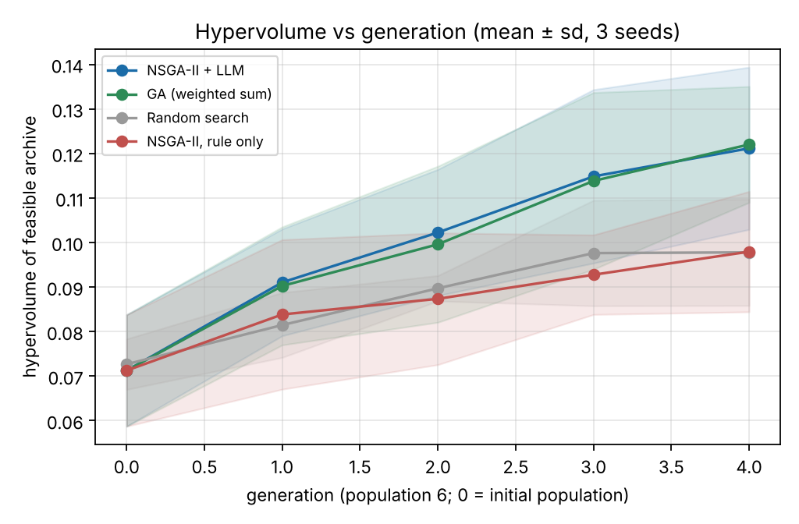
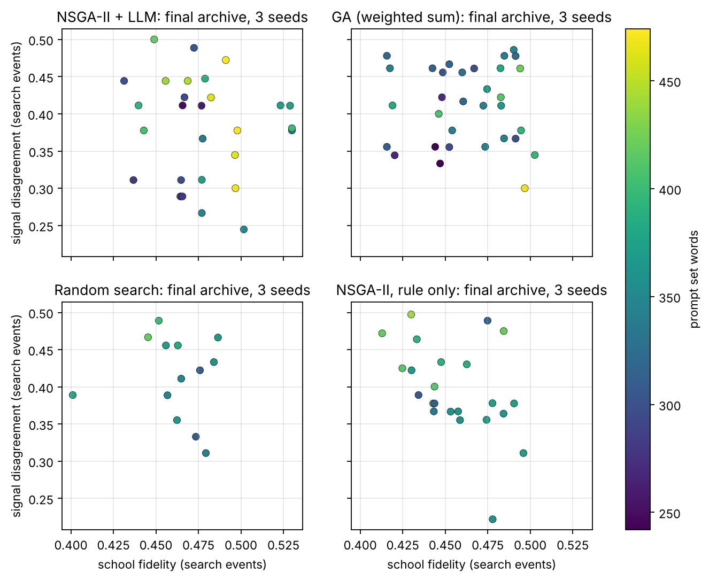
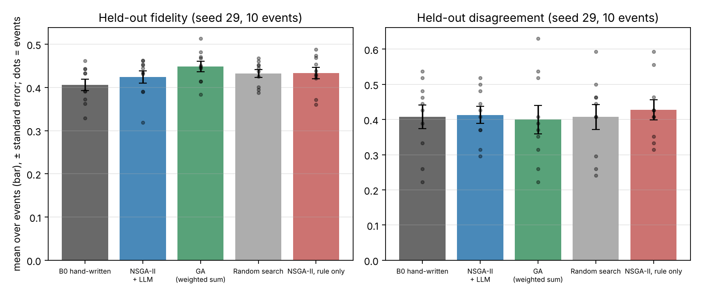
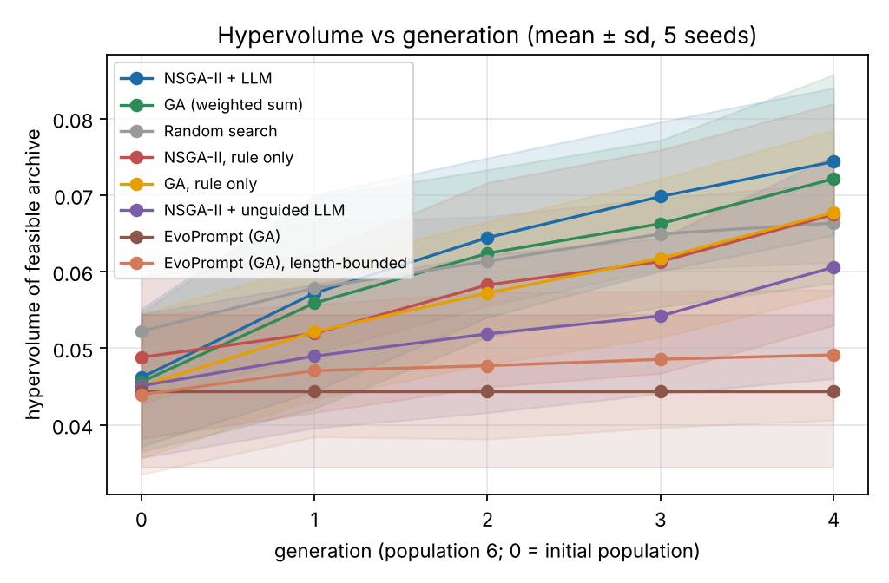

> 本文件為英文報告 `report.md` 的繁體中文版本，內容與數字以英文版為準。

# 摘要

多觀點的 LLM 代理只有在每個代理忠於自己的觀點、而且代理之間彼此有所區別時才有用。提示詞最佳化的既有研究通常只針對一個分數調整一個提示詞，因此忠實度、彼此區別與提示詞長度之間的取捨並沒有被直接搜尋。我們把三個經濟學派代理（凱因斯、奧地利、貨幣學派）的設計表述為一個以提示詞「集合」為對象的受限多目標問題，以 NSGA-II 搜尋，並提出一種 LLM 突變：把父代最弱的目標轉換成改寫指令。在主模型上（`qwen3.8-max`，族群 6、四代、三個種子），完整的消融顯示，選擇機制在此預算下沒有差別，而帶來增益的是「引導」：引導式 LLM 突變的超體積約為 0.12，規則突變與不含目標資訊的 LLM 改寫則約為 0.10，且在每個種子中都勝過兩者。在 Claude Haiku 5.5 上以五個種子重現所有組別，五個中有四個方向相同，但較不明確，因為一條以第一個模型調整的長度規則拒絕了它一半的改寫。與已發表的 EvoPrompt-GA 相比，逐字照錄的運算子在這個有長度與格式限制的問題上失效；在看到該結果後加入的長度受限變體，則在五個種子中都落後於引導式方法（單側 p = 0.031）。在兩個模型的保留事件上，經 Holm 校正後沒有任何方法勝過手寫提示詞，而隨機搜尋取得的忠實度增益與演化方法相當；搜尋得到的集合短了 20% 至 30%，忠實度與分歧相近。所有協定、原始模型輸出（共 13,121 次呼叫，總計約 USD 33）與分析程式碼都已公開。

**關鍵字：** 演化式提示詞最佳化、多目標演化演算法、NSGA-II、LLM 引導突變、多代理多樣性、品質多樣性。

# 1 緒論

## 1.1 問題與動機

由多個 LLM 代理組成、每個代理從不同觀點發言的系統，正越來越多地用於分析、預測與辯論 [@Baltaji2024persona; @Takano2025hawkish]。這類系統的價值取決於兩個方向相反的性質。每個代理必須*忠於*自己的觀點，而且代理彼此必須*有所區別*，否則整個系統會塌縮成單一聲音。近期證據正指向這種失敗：辯論與集成系統會因從眾與多數壓力而喪失多樣性 [@Wu2025debate; @Zhu2026demystifying]；對齊後的模型也會在大量開放式問題上產生同質化的輸出 [@Jiang2025hivemind]。提示詞是設定觀點最便宜的槓桿，但通常仍由人工撰寫。

演化式提示詞最佳化可以在 LLM 提供變異運算子的情況下自動搜尋提示詞 [@Fernando2024promptbreeder; @Guo2024evoprompt; @Lange2024large]。然而這些方法都是針對一個純量分數最佳化一個提示詞。目前沒有任何方法演化的是一*組*提示詞，其中每個成員本身都要表現良好，並且彼此不同；也沒有任何方法能顯示忠實度、區別性與成本（提示詞長度）之間的取捨。多目標提示詞搜尋已經開始出現 [@Zhao2025pareto; @Camara2025moprompt]，但我們沒有找到針對多代理集合的此類研究。

作者碩士論文的一項尚未發表的初步結果也指向同一方向（本專題的量測工具即借自該論文的 harness）。在一項包含六個經濟學框架、共 240 次請求的分歧矩陣中（合成事件、生成器 seed 11、模型識別碼同為 `qwen3.8-max`），三個訓練過的學派彼此的分歧約為同一學派自我重複時的兩倍，而新凱因斯學派在雜訊範圍內與凱因斯學派重合。此證據在本文中只作為動機使用；其中的事件與輸出都沒有進入以下的實驗。

## 1.2 研究問題

- **RQ1.** 以 LLM 引導突變的 NSGA-II 搜尋提示詞集合，能否找到在忠實度、代理間分歧與長度三方面，支配手寫基線以及單目標或隨機搜尋的提示詞集合？
- **RQ2.** 哪一個元件帶來效果：選擇機制、LLM 突變本身，還是 LLM 突變中「依目標引導」的部分？
- **RQ3.** 這些增益能否推廣到未見過的事件？
- **RQ4.** 本方法與已發表的演化式提示詞最佳化方法（EvoPrompt-GA）相比如何？結論在另一家供應商的第二個模型上是否成立？

## 1.3 貢獻

1. **表示法與目標。** 一個個體是三個學派基因的集合（diagnosis、concepts、stance、contrast），以未修改的論文提示詞模板解碼。目標為學派忠實度、學派間分歧與提示詞長度，並以 Deb 的約束處理法處理輸出有效性。
2. **運算子。** 學派層級與欄位層級的結構化交叉；每個子代只改動一個學派的規則突變；以及 LLM 引導突變，即把父代最弱的目標轉換成改寫指令（AI 到 EC）。
3. **評估設計。** 完整的 2 × 2 消融（選擇 × 突變）、一個讓 LLM 在不知道目標的情況下改寫的對照組、一個已發表的基線（EvoPrompt-GA），以及在第二個模型（Claude Haiku 5.5，五個種子）上重現所有組別。
4. **協定。** 一份書面分析協定與三份附錄，每一份都在它所規範的實驗執行之前提交（第 4.8 節）；來自獨立種子的保留事件、經 Holm 校正的精確符號翻轉檢定，以及可以從已提交的原始輸出離線重跑的完整快取流程。

# 2 文獻回顧

我們收集了 34 篇 2024–2026 年的論文（`report/references.bib`）。每篇論文的作者名單與首次提交日期都已對照其 arXiv 頁面核對，期刊論文的 DOI、卷期與頁碼則已對照 Crossref 中的出版社紀錄核對。文獻依主題分組；經典的 Promptbreeder 與 EvoPrompt 也收錄其中，因為它們的正式發表版本來自 2024 年。以下的綜述依方法組織，而不是逐篇摘要。

## 2.1 以 LLM 作為演化變異運算子

目前最強的趨勢，是把 LLM 當作演化迴圈中的突變與交叉運算子。Promptbreeder 同時演化任務提示詞與突變提示詞本身 [@Fernando2024promptbreeder]；EvoPrompt 把 LLM 產生的交叉與突變與 GA、DE 結合，用於離散提示詞 [@Guo2024evoprompt]；EvoLLM 則把 LLM 當成演化策略中的情境內重組步驟 [@Lange2024large]。除了提示詞之外，LLM 也用於設計啟發式與演算法：EoH 以自然語言的思路與程式碼共同演化 [@Liu2024evolution]；ReEvo 為交叉與突變加入反思式的文字回饋 [@Ye2024reevo]；LLaMEA 產生的元啟發式在 BBOB 上勝過 CMA-ES [@vanStein2024llamea]；Eureka 則根據模擬器回饋演化獎勵函數的程式碼 [@Ma2024eureka]。自動設計代理系統把同樣的想法應用到整個代理上，但它使用的是存檔而非選擇族群 [@Hu2025automated]。綜述把這些方法放在同一個框架中，LLM 可以扮演最佳化器、預測器、萃取器或設計者的角色 [@Wu2025evolutionary; @Liu2026systematic]。近期工作也提供指引，決定該選哪個父代、呼叫哪個運算子，以節省模型呼叫次數 [@Wang2026how]。

**缺口。** 這些工作幾乎都只最佳化單一適應度值。即使出現多樣性，它也只是單次搜尋內部的探索手段，而不是一個目標。

## 2.2 以 LLM 進行多目標與品質多樣性搜尋

以 Pareto 為基礎的提示詞搜尋正在興起。Pareto Prompt Optimization 以基於支配關係的偏好損失訓練提示詞生成器，而不是固定的純量化 [@Zhao2025pareto]。MOPrompt 以多目標演化搜尋在準確率與上下文長度之間取捨，並在一項情感分析任務上報告：在達到最佳基線的準確率時，提示詞縮短 31% [@Camara2025moprompt]。REMoH 在 LLM 產生的啟發式外圍包裹 NSGA-II，並以分群的反思步驟維持子代的多樣性 [@Fornies2025remoh]；一個 LLM 輔助的 MOEA 只在代理模型認為值得時才呼叫 LLM [@Liu2024llm]。在品質多樣性方面，LLM 可以在情境內提出存檔成員 [@Lim2024incontext]；MAP-Elites 以結構描述子探索提示詞空間 [@Santos2025diverse]；CycleQD 輪流把其中一個目標當作品質量測，其餘目標當作行為軸 [@Kuroki2025cycleqd]。

**缺口。** 目前的多目標 LLM 搜尋只針對單一任務上的準確率與成本。沒有任何工作使用*代理間*的區別性目標，也沒有任何工作在保留事件上評估提示詞集合。

## 2.3 多代理 LLM 系統中的多樣性與觀點忠實度

多代理討論可以提高觀點的多樣性，但從眾與虛構會侵蝕這種多樣性。被指定人設的代理在辯論指令下會偏離原先指定的觀點 [@Baltaji2024persona]。原始的辯論常常不如多數投票；若明確地分散初始觀點並校準信心，則有助益 [@Zhu2026demystifying]。在一項受控的邏輯研究中，群體多樣性與推理能力最為關鍵，而多數壓力會抑制獨立的修正 [@Wu2025debate]。多樣性的塌縮不只發生在單一模型內部，也發生在模型之間：一項開放式研究同時發現模型內部的重複與模型之間的同質化 [@Jiang2025hivemind]。在經濟推理方面，LLM 傾向於做出偏向干預的因果結論，而且這種偏向在單次提示下依然存在 [@Lee2026ideological]。具有明確鷹派與鴿派信念的總體代理，可以改善 FOMC 分類的表現，但該研究沒有檢查代理在多輪之間是否仍忠於其信念 [@Takano2025hawkish]。以 LLM 代理進行的調查模擬，只有在注入先驗信念後，才能與總體期望分布相符 [@Lin2025simulating]。

自動化的多代理設計也很活躍。MASS 分三階段最佳化提示詞與拓撲，但只使用單一任務分數 [@Zhou2026mass]。EvoMAS 則以執行軌跡引導的突變與交叉，演化多代理配置 [@Hu2026evomas]。

**缺口。** 多樣性在既有研究中被當成提升準確率的手段，或者只是被量測的性質；但沒有人把它與觀點忠實度一起當成最佳化目標，更沒有人針對互相競爭的經濟觀點這樣做。

## 2.4 演化式模型合併、微調與自我演化

本節屬於相鄰領域，之所以納入，是因為它在課程提供的研究方向清單中；它是與本研究最接近、以族群為基礎、但改變的是模型權重而非提示詞文字的替代路線。演化也被應用於參數與配方，而不是文字。以演化搜尋合併配方（在參數與資料流空間中）已產生日文最先進的模型 [@Akiba2025merging]。多目標演化合併的專家模型，在跨任務表現與儲存成本之間取捨 [@Qiu2026modular]；LLM 區塊的二維重組則以雙層多目標演化搜尋 [@Wu2026lego]。分層合併推理調校過的 LLM，是另一條結合專門化模型的路線 [@Zhang2024unconstrained]。演化策略可以在不用梯度的情況下微調數十億參數的 LLM [@Qiu2026es]；黑箱演化合併只需要 API 查詢 [@Chen2025evomerging]。自我演化的訓練則在沒有人工標註的情況下，共同演化評分量規產生器與策略模型 [@Li2026evolm]。

**缺口。** 這些方法都在最佳化權重，因此需要訓練或合併的基礎設施。本研究的設定中，唯一的決策變數是少數提示詞的文字，因此是同一族方法中一個成本較低、也更容易解釋的位置。

## 2.5 綜合與定位

表 1 以與本研究相關的軸線，總結這些文獻。

| 軸線 | 典型發現 | 與本設計的關係 |
|---|---|---|
| LLM 作為運算子 | 適用於提示詞、啟發式與程式碼 [@Fernando2024promptbreeder; @Guo2024evoprompt; @Liu2024evolution] | 我們使用帶有目標導向指令的 LLM 突變 |
| 目標 | 多為單一純量；Pareto 變體存在於準確率與成本的取捨中 [@Zhao2025pareto; @Camara2025moprompt] | 三個目標，其中之一是代理間的區別性 |
| 多樣性 | 被量測或用作初始化；同質化已有文獻記錄 [@Jiang2025hivemind; @Zhu2026demystifying] | 明確作為一個目標 |
| 觀點忠實度 | 在辯論下會侵蝕 [@Baltaji2024persona; @Wu2025debate] | 以詞典量測；在獨立事件上保留檢驗 |
| 評估 | 多為單一任務；很少有保留檢驗 | 搜尋與保留的種子彼此獨立；消融結果一併報告 |

**本研究的定位。** 就我們所知，沒有任何一篇論文同時具備：(i) 以一組代理提示詞作為一個個體；(ii) 在忠實度與長度之外，加入代理間區別性的目標；(iii) 以 LLM 作為突變運算子，並由最弱的目標引導；以及 (iv) 在未見過的事件上做保留檢驗。我們把這個定位視為從本次文獻回顧中找出的缺口，而不是新穎性的證明。

# 3 方法

## 3.1 問題表述

一個個體是一組提示詞 $P = (g_{\text{kw}}, g_{\text{au}}, g_{\text{mo}})$，每個學派各有一個基因。對於一組合成事件 $E$，每個學派對每個事件都會給出可解析的報告，或是失敗。三個目標皆為最小化，且都在 $[0,1]$ 範圍內：

- $g_1 = 1 - \text{fidelity}(P)$，其中忠實度是各學派回答的詞典一致性平均值（論文中的一致性分數 $C_s$）。
- $g_2 = 1 - \text{disagreement}(P)$，其中分歧是三個學派兩兩之間信號分歧的平均值（`mosaic.divergence.distance`）。
- $g_3 = \min(1, \text{words}(P)/600)$。

可行性要求至少 90% 的學派輸出可以解析。不可行的集合依其違反程度排序，遵循 Deb 的規則。

## 3.2 基因與解碼

每個學派的基因有四個部分：`diagnosis`（句子）、`concepts`（概念池的一個有序子集）、`stance`（描述典型事件解讀的句子），以及可選的 `contrast`（「不同於其他學派，你……」形式的句子）。解碼時填入未經修改的 `mosaic.divergence.messages()` 模板，因此輸出格式（因果鏈、情境、信號）與事件都和論文的 harness 完全相同。初始族群是手寫基線 B0，加上它的微擾副本。

## 3.3 變異

- **結構化交叉**（機率 0.7）。以 0.5 的機率在父代之間整體交換學派基因；否則，每個學派的每個欄位都從其中一個父代挑選。
- **規則突變。** 選定一個學派，套用一到兩個運算子：刪除或交換 diagnosis 的句子，刪除、新增或重排概念。它一次只改一個學派，因此其他兩個學派的輸出可以直接沿用快取。沒有任何規則運算子會新增 diagnosis 句子，也不會改動 `stance` 與 `contrast`，因此規則突變只會維持或縮短它所改動的文字（新增概念只多幾個字）。這種偏向較短集合的傾向，在解讀長度結果時很重要（第 5.2 節）。
- **LLM 引導突變**（在 LLM 方法的突變中，機率為 0.5）。父代的評估結果決定要改善哪個目標，選擇機率與其表現之差成正比：忠實度（用該學派的詞典詞彙改寫最不忠實學派的 diagnosis）、分歧（改寫兩個最相似學派之一的某個欄位，使其與另一個學派做出不同的判斷）、或長度（把最長學派的 diagnosis 縮短為 40 字）。模型回傳一段文字；若字數介於 5 到 120 之間則接受，否則子代退回為規則突變（在 qwen 上，三個種子合計，NSGA-II 的 30 個 LLM 子代中有 8 個、GA 的 34 個中有 10 個以此方式被退回；在 Haiku 上約為一半，見第 5.3 節）。

## 3.4 選擇

- **NSGA-II。** 受約束的非支配排序、擁擠距離、以（秩，擁擠度）為準的二元錦標賽，以及精英式的 $(\mu+\lambda)$ 環境選擇 [@Deb2002]。
- **GA（B2）。** 使用相同的運算子，但選擇時先看可行性，再看 $g_1, g_2, g_3$ 的等權加總。這樣可以單獨隔離選擇機制的效果。

## 3.5 基線、消融與指標

- **B0。** 手寫的學派設定，以三個獨立的取樣種子評估。
- **B1 隨機搜尋。** 對 B0 做獨立的隨機規則微擾（每個學派 1 至 3 個運算子），評估次數與其他方法相同，並使用相同的存檔。
- **消融。** 只使用規則突變的 NSGA-II，以及只使用規則突變的 GA；與兩個 LLM 組別合起來構成 2 × 2 設計（選擇 × 突變）。
- **不引導的 LLM 對照組。** 使用不含任何目標資訊之 LLM 突變的 NSGA-II：呼叫方式、比例與接受規則都與引導式運算子相同，但學派與欄位（diagnosis 或 stance）隨機抽取，指令固定為「Rewrite this paragraph in your own words. Keep its meaning and keep it as one paragraph.」。它把「引導」與「讓 LLM 改寫」本身分開。
- **已發表的基線：EvoPrompt (GA)** [@Guo2024evoprompt]。以分數 $1 - \bar g$ 用輪盤法選父代；每個子代的每個學派各呼叫一次 LLM，套用論文的交叉加突變模板（逐字照錄，論文 Figure 1）於兩個父代的 diagnosis 段落；父代與子代合併後保留最好的 $N$ 個。有四處必要的調整，並明確標示為調整：運算子作用於三個學派（論文只演化一個提示詞）；`<prompt>` 括號內的答案在 5 至 600 字之間即接受（論文的運算子會寫出完整提示詞，見第 4.8 節）；最終解採用共同的拐點規則，而不是 EvoPrompt 的 argmax；初始族群採用共同的族群（B0 加上微擾副本），論文同樣以人工提示詞起始。
- **指標。** 可行非支配存檔的精確三維超體積，參考點為 (1, 1, 1)。存檔保留所有被評估過的可行集合，因此所有方法都在相同的基礎上比較。
- **拐點（knee）。** 最接近理想點 (0, 0, 0) 的存檔成員。此規則在保留事件分析之前已寫入 `code/PROTOCOL.md`。各目標沒有重新縮放；在最終前沿上，$g_3$ 的範圍約為 0.40 至 0.79、$g_2$ 約為 0.50 至 0.78，而 $g_1$ 只有約 0.47 至 0.60，因此忠實度在距離中的權重最小，拐點往往是較短的可行集合之一。

# 4 實驗設定

## 4.1 任務與資料

任務是由 `mosaic.teacher.make_items` 產生的一組合成總體經濟事件。搜尋集是 seed 23 的前五個事件，保留集是 seed 29 的前十個事件。搜尋集與保留集的*事件內容*並不重疊，但有一例外：保留事件 `syn-k0007`（seed 29）與搜尋事件 `syn-k0002`（seed 23）的文字完全相同，雖然兩者的 macro context 不同。第 5.2 節會報告移除該事件後的檢定結果。Seed 11（論文中的分歧矩陣）與論文的所有保留檔案都沒有使用。詞典來自 `configs/lexicons.toml`，論文將其標為 PROVISIONAL（暫定）；這會影響忠實度目標（見第 6 節）。

## 4.2 模型與後端

**主模型。** 每次呼叫都送到 OpenAI 相容的端點（模型為 `qwen3.8-max`，即論文中分歧矩陣所用的模型），溫度 0.7、top-p 0.9、最多 1,024 個輸出 token、關閉 thinking，並使用每次執行各自的取樣種子。每個回應都會存入一個只能追加的快取，快取的鍵由模型、訊息與取樣參數組成（`results/cache/llm_cache.jsonl`）。一個帳本記錄 token 數與估計花費，每個指令各有上限。花費使用假設的標準單價，每百萬輸入與輸出 token 分別為 USD 2.4 與 9.6；實際量測到的 token 數都有保存，因此可以依供應商的價目表重新計算。

**第二個模型。** 重現實驗透過 Anthropic 官方 SDK 使用 `claude-haiku-5-5`。此模型不接受非預設的溫度與 top-p，因此使用其預設取樣；與 qwen 相同，關閉 thinking，輸出上限 1,024 token。此 API 沒有取樣種子，因此種子保留在快取鍵中（每個種子各自取樣），但不送出。此模型的所有資料都存放在 `results/haiku/`，使用獨立的快取；帳本採用每百萬 token USD 0.10 與 0.50 的標準價格。

## 4.3 超參數

| 參數 | 數值 |
|---|---|
| 族群大小 $N$ | 6 |
| 世代數 $G$ | 4（因此每次執行 $N(G+1) = 30$ 次評估） |
| 搜尋事件／保留事件 | 5 / 10 |
| 演算法種子（跨方法配對） | 1、2、3（qwen）；1 至 5（Haiku） |
| 交叉／突變／LLM 比例 | 0.7 / 0.9 / 0.5 |
| 錦標賽大小 | 2 |
| 可行性門檻 | 0.9 |
| 長度正規化 | 600 字 |
| 超體積參考點 | (1, 1, 1) |
| LLM 改寫的字數範圍 | 5 至 120 字（引導與不引導的改寫）；5 至 600 字（EvoPrompt 的答案） |
| 取樣 | qwen：溫度 0.7、top-p 0.9；Haiku：供應商預設；兩者皆最多 1,024 token、關閉 thinking |

## 4.4 流程

1. 對每種方法與每個種子，在五個搜尋事件上執行搜尋，並保留存檔（`results/runs/<方法>_s<種子>/gen_log.csv`、`evaluations.jsonl`、`front.jsonl`）。
2. 從最終存檔中選出拐點，寫入 `results/best_prompts/`。
3. 在十個保留事件上重新量測每個拐點，以及 B0。每個拐點也會逐事件地從快取重新評分（`results/heldout_per_event.csv`）。
4. 對每個事件，將各種子的平均值作為該事件的值；對每種方法與 B0 做精確的配對符號翻轉檢定（十個事件），並對該模型所有「方法對 B0」的檢定做 Holm 校正（`results/heldout_tests.csv`）；協定的檢定族另外加入所有「方法對方法」的檢定（`results/heldout_tests_protocol.csv`）。

## 4.5 統計方法

搜尋層級的結果以三個種子的平均值 ± 樣本標準差表示。以三個配對種子進行的符號翻轉檢定，單側 p 值最小只能到 1/8，因此 qwen 的搜尋層級比較只作描述性報告，並列出每個種子的差異；五個種子（Haiku）時最小為 1/32，並報告精確的單側 p 值。推論性檢定使用十個保留事件，其雙側 p 值最小可能為 2/1024。保留事件的區間估計為 95% 百分位自助法區間（十個事件上重抽 10,000 次，`mosaic.stats.paired`，種子 0）。這些區間沒有經過多重比較校正；p 值則是精確的符號翻轉值，並以 Holm 校正。

## 4.6 重現

`code/README.md` 說明了執行指令。qwen 矩陣的執行指令為 `python -m evo_prompt.runner --methods b0 nsga2 ga random nsga2_rule --seeds 1 2 3 --gens 4 --pop 6 --heldout --budget 30`，兩個消融組別以 `--methods ga_rule nsga2_llmu` 與相同設定執行，Haiku 重現則加上 `--profile haiku` 並使用種子 1 至 5（確切指令見各協定附錄）。表格由 `python -m evo_prompt.analyze` 產生（重現實驗加上 `--profile haiku`），圖形由 `python -m evo_prompt.figures` 產生。分析只讀取已提交的快取，因此不會發出任何模型呼叫。

## 4.7 計算環境與實測性能

**硬體。** 搜尋與分析在僅有 CPU 的 Linux 機器上執行（x86_64，無 GPU）。語言模型是透過 HTTPS 經由 OpenAI 相容的聊天端點存取，因此模型本身的硬體不在我們的控制範圍內。

**軟體。** Python 3.13.18；numpy 2.5.3（分析）、matplotlib 3.11.2（圖形）、pytest 9.2.0（測試）。qwen 用戶端只使用 Python 標準函式庫；Haiku 用戶端使用官方 `anthropic` SDK 2.3.0。以上版本為產生報告結果時的環境版本；沒有提供鎖定檔。

**並行。** qwen 每批模型呼叫最多同時送出 16 個請求；Haiku 最多 8 個，進入並行階段後（第 4.8 節）每個程序最多 6 個，最多 7 個程序。每個回應都會在下一批開始前寫入快取。

**實測性能。** 以下數字來自快取，快取記錄了每次呼叫的回應時間與 token 數。

- qwen 紀錄的呼叫次數：3,709 次，其中 2,743 次屬於主矩陣，106 次屬於 API 煙霧測試，675 次屬於兩個消融組別，185 次屬於未完成的 EvoPrompt 執行。
- qwen 每次呼叫的延遲：中位數 14.9 秒、平均 15.0 秒、第 90 百分位 17.3 秒、最大 183.9 秒；token 總數為輸入 2,510,128 個、輸出 2,217,418 個。
- Haiku 紀錄的呼叫次數：9,412 次（不含附錄 B 的煙霧測試）；每次呼叫的延遲中位數 5.6 秒、平均 5.7 秒、第 90 百分位 7.0 秒、最大 10.0 秒；token 總數為輸入 9,261,362 個、輸出 8,710,072 個；延遲加總約 14.9 小時。
- 把 qwen 各次呼叫的延遲加總約為 15.4 小時。這不是牆鐘時間，因為請求是並行執行的；牆鐘時間沒有被記錄。
- 27 個離線測試大約在一秒內完成。

## 4.8 協定、附錄與偏離

分析依循 `code/PROTOCOL.md` 與四份附錄。每份附錄都在它所規範之實驗的第一次模型呼叫之前提交；提交時間（UTC，2026-11-02）可在 git 紀錄中查證。

| 文件 | 提交 | 規範範圍 |
|---|---|---|
| `PROTOCOL.md` | `b3cfd5e`（2026-11-01） | qwen 主矩陣（B0、NSGA-II + LLM、GA、隨機搜尋、NSGA-II 僅規則突變） |
| 附錄 A | `78cb5a1`（04:19） | qwen 上的 GA 僅規則突變與 NSGA-II + 不引導 LLM；問題 Q1 至 Q3 及其判讀規則 |
| 附錄 B | `c58798a`（04:29） | 所有組別在 Haiku 上的重現，種子 1 至 5 |
| 附錄 C | `507545a`（04:37） | EvoPrompt-GA 基線；Haiku 實驗的並行執行 |
| 附錄 D | `f5e935e`（05:00） | Haiku 上長度受限的 EvoPrompt 變體（事後追加，見第 7 點） |

分析在以下幾處偏離這些文件或其措辭。

1. **主協定的時間點。** `PROTOCOL.md` 寫明它在任何完整矩陣結果出現之前寫成。實際上它是在矩陣執行期間提交的（2026-11-01 15:12 UTC），同一次提交中已含有 NSGA-II、GA 與隨機搜尋種子 1 的拐點提示詞集合。執行器在每次執行結束時就會在保留事件上量測拐點，因此當時可能已有部分種子 1 的保留數值。保留事件的表格、檢定與圖形都是之後產生的。因此主協定是在保留事件「分析」之前固定的，而不是在所有結果之前；我們不稱之為事前註冊。各附錄沒有這個問題。
2. **檢定族。** 協定的 Holm 校正涵蓋「方法對 B0」與「方法對方法」的比較。表 3 與表 4 只使用「方法對 B0」的檢定（qwen 為 12 個）。完整的檢定族（qwen 為 12 + 30 = 42 個，Haiku 為 16 + 56 = 72 個）見 `results/heldout_tests_protocol.csv` 及其 Haiku 對應檔；Holm 調整後最小的 p 值，qwen 為 1.0、Haiku 為 0.425，結論不變。
3. **事後的敏感度分析。** 移除與搜尋事件文字重複的保留事件（第 5.2 節）不在協定之中，是發現重複之後才加入的。
4. **EvoPrompt 的接受規則（附錄 C 的修正）。** 附錄 C 起初把我們改寫運算子的 5 至 120 字規則套用在 EvoPrompt 的答案上。qwen 第一代的 18 個答案都有 143 至 370 字，全部被拒絕，基線等於在沒有變異的情況下執行。在任何適應度比較之前，這個組別的規則改為 5 至 600 字（`187dc01`，04:38）；過長的答案改由長度目標懲罰，而不是直接丟棄。被停止的第一次執行已寫出種子 1 的搜尋檔案；這些檔案未經開啟即移出 `results/`。
5. **qwen 的 EvoPrompt 未完成。** 重新啟動的 EvoPrompt 執行在種子 1 的第 2 代時用完了 qwen 額度。依附錄 C 的規定，此組別記為未完成，並排除於所有 qwen 表格之外；與已發表基線的比較只在 Haiku 上進行。
6. **Haiku 的並行執行。** 為了加快速度，循序執行的 Haiku 實驗在 B0 與 NSGA-II 種子 1 至 3 完成後停止，其快取凍結為唯讀基底，其餘組別（之後還有兩個最慢組別的個別種子）在各自的程序中以獨立的快取層執行。因此各組別不共用凍結之後抽出的樣本，Haiku 上 NSGA-II 與 GA 等組別的軌跡比 qwen 上更不耦合。這只改變執行方式，不改變設計。這也表示種子 4 與 5 的初始族群是由各組別分別取樣的，因此 Haiku 各組別第 0 代的超體積略有不同（圖 4）。
7. **事後追加的變體。** 附錄 D 是在看到並分析過 Haiku 上 EvoPrompt 的結果之後才寫的。它加入了讓該基線能在此問題上運作的最小修改；逐字照錄的基線也一併報告，而且此變體在每個出現之處都標明為事後追加。

# 5 結果與分析

## 5.1 主模型：搜尋層級

表 2 報告六個 qwen 組別在搜尋事件上的存檔與拐點。數值為三個種子的平均 ± 標準差（`results/summary_table.md`）。

| 方法 | 超體積 | 前沿大小 | 拐點忠實度 | 拐點分歧 | 拐點有效率 | 拐點字數 |
|---|---|---|---|---|---|---|
| NSGA-II + LLM | 0.1211 ± 0.0182 | 9.3 ± 1.5 | 0.461 ± 0.026 | 0.460 ± 0.025 | 0.978 ± 0.039 | 330 ± 50 |
| GA（加權和） | 0.1220 ± 0.0130 | 10.7 ± 1.2 | 0.452 ± 0.038 | 0.459 ± 0.032 | 1.000 ± 0.000 | 305 ± 29 |
| 隨機搜尋 | 0.0978 ± 0.0119 | 4.3 ± 0.6 | 0.474 ± 0.011 | 0.437 ± 0.017 | 1.000 ± 0.000 | 350 ± 38 |
| NSGA-II 僅規則突變 | 0.0979 ± 0.0135 | 7.7 ± 4.0 | 0.460 ± 0.016 | 0.429 ± 0.061 | 0.933 ± 0.000 | 346 ± 37 |
| GA 僅規則突變 | 0.0985 ± 0.0201 | 7.7 ± 2.1 | 0.456 ± 0.032 | 0.463 ± 0.026 | 0.933 ± 0.000 | 356 ± 52 |
| NSGA-II + 不引導 LLM | 0.1022 ± 0.0320 | 9.7 ± 2.9 | 0.459 ± 0.027 | 0.418 ± 0.013 | 1.000 ± 0.000 | 338 ± 71 |

圖 1 顯示每一世代的平均超體積。第 0 代是共用的初始族群（除隨機搜尋為 0.073 外，其餘組別皆為 0.071）。兩個使用引導式 LLM 突變的組別從第 1 代起就高於其他組別，最終達到 0.121 與 0.122；三個規則式組別與不引導的對照組最終介於 0.098 與 0.102 之間。

表 2b 把最終超體積排成「選擇 × 突變」的 2 × 2 設計，並列出不引導的對照組。

| 選擇 | 僅規則突變 | 引導式 LLM 突變 | 不引導 LLM 突變 |
|---|---|---|---|
| GA（加權和） | 0.0985 | 0.1220 | 未執行 |
| NSGA-II | 0.0979 | 0.1211 | 0.1022 |

附錄 A 在兩個新組別執行之前就固定了三個問題與一條判讀規則：只有當三個配對種子的正負號全部一致時，才算方向一致（單側符號翻轉 p = 1/8，三個種子所能達到的最小值）。

| 問題 | 比較 | 種子 1 | 種子 2 | 種子 3 | 平均 | 一致 |
|---|---|---|---|---|---|---|
| Q1 選擇，規則突變下 | GA 規則 − NSGA-II 規則 | −0.0019 | −0.0049 | +0.0085 | +0.0006 | 否 |
| Q2 LLM 突變，GA 選擇下 | GA − GA 規則 | +0.0235 | +0.0463 | +0.0007 | +0.0235 | 是 |
| Q3 引導 | NSGA-II + LLM − NSGA-II + 不引導 LLM | +0.0327 | +0.0212 | +0.0029 | +0.0189 | 是 |

qwen 上 RQ2 的答案現在很直接。

- **選擇機制在此不重要。** 規則突變下，兩種選擇機制的超體積相同，且各種子的正負號不一致（Q1）；在引導式 LLM 突變下，兩者最後也相同（0.1211 對 0.1220）。族群 6、四代的設定讓兩種機制幾乎沒有拉開差距的空間，所以這是針對此預算的陳述。
- **LLM 突變在兩種選擇機制下都有幫助。** 在 GA 選擇下，它在三個種子中都提高了超體積（Q2）；在 NSGA-II 下，相對於僅規則突變的消融也是如此（0.114 對 0.087、0.108 對 0.093、0.142 對 0.113）。
- **有效的是引導，而不是 LLM 改寫本身。** 不引導的對照組最終為 0.102，接近規則式組別，而引導式運算子在三個種子中都勝過它（Q3）。這是支持第 3.3 節所提運算子最直接的證據。
- **強度。** 以上三點都只建立在三個配對種子上。Q2 與 Q3 在種子 3 的差異很小（+0.0007 與 +0.0029），而且種子 2 的隨機搜尋（0.112）最終高於種子 2 的 NSGA-II + LLM（0.108）。第 5.3 節在第二個模型上以五個種子重複這些問題。

圖 2 顯示多出來的超體積從何而來。有 LLM 突變的組別能找到最短的集合（242 至 256 字）；所有規則式組別都在 292 字以上。引導式 NSGA-II 的存檔也達到最高的忠實度（0.53），而不引導的對照組不超過 0.496。

## 5.2 主模型：保留事件

表 3 報告十個保留事件上拐點與 B0 的結果。表中 ± 的性質並不相同：B0 的 ± 是同一個固定提示詞集合在三個取樣種子間的變異；搜尋方法的 ± 則是三個演算法種子間的變異，每個種子產生不同的拐點提示詞集合（並以各自的取樣種子評估）。後者包含前者。

| 方法 | 忠實度 | 分歧 | 有效率 | 字數 |
|---|---|---|---|---|
| B0 手寫 | 0.406 ± 0.002 | 0.407 ± 0.028 | 0.989 ± 0.019 | 438 |
| NSGA-II + LLM | 0.424 ± 0.017 | 0.423 ± 0.006 | 0.989 ± 0.019 | 330 ± 50 |
| GA（加權和） | 0.448 ± 0.043 | 0.419 ± 0.027 | 0.978 ± 0.019 | 305 ± 29 |
| 隨機搜尋 | 0.432 ± 0.009 | 0.432 ± 0.024 | 0.967 ± 0.033 | 350 ± 38 |
| NSGA-II 僅規則突變 | 0.433 ± 0.032 | 0.428 ± 0.048 | 1.000 ± 0.000 | 346 ± 37 |
| GA 僅規則突變 | 0.433 ± 0.006 | 0.415 ± 0.075 | 1.000 ± 0.000 | 356 ± 52 |
| NSGA-II + 不引導 LLM | 0.441 ± 0.017 | 0.372 ± 0.037 | 1.000 ± 0.000 | 338 ± 71 |

表 4 給出配對檢定的結果。每個比較都使用十個保留事件，Holm 校正涵蓋十二個「方法對 B0」的檢定。

| 比較 | 指標 | 平均差（方法 − B0） | 95% 自助法區間 | p（精確，未校正） | p（Holm） |
|---|---|---|---|---|---|
| NSGA-II + LLM − B0 | 忠實度 | +0.0179 | [-0.0086, +0.0413] | 0.2168 | 1.0000 |
| NSGA-II + LLM − B0 | 分歧 | +0.0056 | [-0.0649, +0.0725] | 0.8672 | 1.0000 |
| GA（加權和）− B0 | 忠實度 | +0.0426 | [+0.0133, +0.0734] | 0.0293 | 0.3223 |
| GA（加權和）− B0 | 分歧 | -0.0074 | [-0.0889, +0.0704] | 0.8848 | 1.0000 |
| 隨機搜尋 − B0 | 忠實度 | +0.0262 | [+0.0084, +0.0437] | 0.0254 | 0.3047 |
| 隨機搜尋 − B0 | 分歧 | +0.0000 | [-0.0813, +0.0741] | 0.9805 | 1.0000 |
| NSGA-II 僅規則突變 − B0 | 忠實度 | +0.0272 | [+0.0041, +0.0503] | 0.0566 | 0.4531 |
| NSGA-II 僅規則突變 − B0 | 分歧 | +0.0204 | [-0.0518, +0.0852] | 0.5664 | 1.0000 |
| GA 僅規則突變 − B0 | 忠實度 | +0.0275 | [+0.0053, +0.0475] | 0.0410 | 0.4102 |
| GA 僅規則突變 − B0 | 分歧 | +0.0075 | [-0.0610, +0.0704] | 0.8086 | 1.0000 |
| NSGA-II + 不引導 LLM − B0 | 忠實度 | +0.0354 | [+0.0080, +0.0632] | 0.0488 | 0.4395 |
| NSGA-II + 不引導 LLM − B0 | 分歧 | -0.0351 | [-0.0907, +0.0278] | 0.3242 | 1.0000 |

經 Holm 校正後，沒有任何比較達到顯著（調整後最小 p = 0.305）。在校正之前，GA、隨機搜尋、GA 僅規則突變與不引導對照組的忠實度增益，其精確符號翻轉 p 值介於 0.025 與 0.049 之間，未校正的自助法區間也都不包含 0；但沒有一個在十二個檢定的校正後成立，在 42 個檢定的協定檢定族中也都不成立（第 4.8 節）。因此我們把這些忠實度增益視為有暗示性的，而非已確立的結果。移除與搜尋事件文字重複的保留事件（第 4.1 節）後，其餘九個事件上的精確符號翻轉 p 值分別為：GA 忠實度增益 0.059、隨機搜尋 0.051、NSGA-II 僅規則突變 0.109、GA 僅規則突變 0.066、不引導對照組 0.082，結論不變。

從表格中可以觀察到四點。

1. **提示詞集合變短了，但忠實度沒有下降。** 搜尋得到的拐點字數為 305 至 356，而 B0 為 438（大約短 20% 至 30%）；忠實度與分歧與 B0 只相差幾個百分點。但這大部分是設計本身造成的，而不是搜尋找到的：規則突變只能縮短 diagnosis（第 3.3 節），而拐點規則對長度的權重高於忠實度（第 3.5 節）。只用規則突變、套用同一拐點規則的隨機搜尋，最後也短了 20%。對按 token 計費的部署而言，長度上的收益是真實的，但它不是演化有效的證據。
2. **引導式 LLM 突變在搜尋層級的優勢，沒有延續到保留事件的忠實度。** 隨機搜尋的忠實度增益（+0.026）高於引導式 LLM 突變的 NSGA-II（+0.018），規則式組別與不引導對照組的增益則為 +0.027 至 +0.035。隨機搜尋在搜尋「過程中」沒有選擇，但它的拐點仍是依拐點規則從搜尋事件上 30 個集合中挑出的最佳者，也就是一種 best-of-30 的選擇。因此，保留事件上的忠實度增益較適合解讀為「在搜尋事件上挑選提示詞集合」本身的效果，而不是任何特定運算子的效果。只有 GA 的增益（+0.043）較大，而且在校正後並不顯著。這是第 6 節結論中最需要保持警惕的地方。
3. **分歧幾乎沒有變化。** 在提示詞集合固定時，B0 自己的三次取樣在保留事件上的分歧範圍就已達 0.406 至 0.433。除了不引導對照組之外，每個搜尋組別都與 B0 相差不到 0.021；不引導對照組的拐點分歧下降了 0.035（0.372），未校正 p 值為 0.32。「不引導的改寫可能讓各學派聽起來更相似」與第 2.3 節的文獻一致，但本實驗無法確立這一點。
4. **搜尋層級的排名沒有延續下去。** 在搜尋事件上，隨機搜尋的拐點忠實度最高（0.474），GA 最低（0.452）；在保留事件上，兩者的順序反過來（0.432 對 0.448）。只有五個搜尋事件時，拐點的選擇部分受雜訊驅動，這也限制了第 5.1 節的搜尋層級比較對泛化能說明的程度。

## 5.3 第二個模型（Claude Haiku 5.5）與已發表的基線

所有組別都以五個種子在 Claude Haiku 5.5 上重新執行（附錄 B），並加入已發表的 EvoPrompt-GA 基線（附錄 C），以及在看到它的結果之後加入的長度受限變體（附錄 D）。表 5 列出搜尋層級的結果（`results/haiku/summary_table.md`）。

| 方法 | 超體積 | 前沿大小 | 拐點忠實度 | 拐點分歧 | 拐點字數 |
|---|---|---|---|---|---|
| NSGA-II + LLM | 0.0744 ± 0.0096 | 7.0 ± 3.6 | 0.283 ± 0.011 | 0.471 ± 0.045 | 323 ± 33 |
| GA（加權和） | 0.0721 ± 0.0136 | 7.2 ± 1.9 | 0.263 ± 0.016 | 0.510 ± 0.058 | 330 ± 30 |
| 隨機搜尋 | 0.0664 ± 0.0052 | 5.8 ± 2.2 | 0.299 ± 0.008 | 0.455 ± 0.027 | 345 ± 26 |
| NSGA-II 僅規則突變 | 0.0675 ± 0.0145 | 7.8 ± 3.1 | 0.276 ± 0.040 | 0.491 ± 0.058 | 344 ± 24 |
| GA 僅規則突變 | 0.0677 ± 0.0107 | 7.2 ± 3.6 | 0.267 ± 0.033 | 0.509 ± 0.064 | 343 ± 19 |
| NSGA-II + 不引導 LLM | 0.0606 ± 0.0146 | 5.2 ± 1.9 | 0.290 ± 0.013 | 0.457 ± 0.071 | 368 ± 44 |
| EvoPrompt (GA) | 0.0444 ± 0.0099 | 3.0 ± 0.7 | 0.254 ± 0.020 | 0.456 ± 0.068 | 392 ± 28 |
| EvoPrompt (GA)，長度受限 | 0.0491 ± 0.0085 | 6.2 ± 0.8 | 0.262 ± 0.020 | 0.483 ± 0.037 | 412 ± 45 |

忠實度的絕對值遠低於 qwen（搜尋事件上為 0.25 至 0.30，qwen 為 0.45 至 0.47）：Haiku 使用的詞典詞彙較少，因此忠實度只能在同一模型內比較，不能跨模型比較。引導式 LLM 突變的 NSGA-II 再次有最高的平均超體積。表 5b 重複附錄 A 的問題，並加入與基線的比較；五個種子時，精確的單側符號翻轉 p 值最小可到 1/32 = 0.031。

| 問題 | 比較 | 種子 1 至 5 | 平均 | 一致 | p（單側） |
|---|---|---|---|---|---|
| Q1 選擇，規則突變下 | GA 規則 − NSGA-II 規則 | −0.007、+0.009、−0.003、+0.009、−0.007 | +0.000 | 否 | 0.500 |
| Q2 LLM 突變，GA 選擇下 | GA − GA 規則 | +0.018、+0.013、+0.010、−0.008、−0.011 | +0.004 | 否 | 0.250 |
| （Q2，NSGA-II 選擇下） | NSGA-II + LLM − NSGA-II 規則 | +0.012、+0.016、+0.005、+0.008、−0.006 | +0.007 | 否 | 0.094 |
| Q3 引導 | NSGA-II + LLM − NSGA-II + 不引導 LLM | +0.027、+0.013、−0.004、+0.000、+0.032 | +0.014 | 否 | 0.094 |
| Q4 已發表基線 | NSGA-II + LLM − EvoPrompt (GA) | +0.033、+0.024、+0.023、+0.024、+0.046 | +0.030 | 是 | 0.031 |
| Q5 長度受限基線 | NSGA-II + LLM − EvoPrompt (GA)，長度受限 | +0.029、+0.023、+0.018、+0.013、+0.043 | +0.025 | 是 | 0.031 |

哪些結果在 qwen 之外也成立，哪些沒有：

- **選擇機制仍然不重要**（Q1，以及 NSGA-II + LLM 對 GA：0.0744 對 0.0721，正負號不一致）。
- **LLM 的效果變弱，也不再一致。** 引導式 LLM 突變在 NSGA-II 下五個種子中有四個勝過規則突變，在 GA 下五個中有三個，並在五個中有四個勝過不引導對照組（Q3，p = 0.094）。方向與 qwen 一致，但未達到附錄 A 的判讀規則（所有種子一致）。紀錄中可以看到一個原因：Haiku 寫的改寫比較長，NSGA-II 的 60 個引導式改寫中有 28 個（47%）、GA 的 54 個中有 27 個（50%）被 120 字的規則拒絕而退回規則突變；qwen 上分別為 27% 與 29%，不引導對照組則為 48 個中 6 個（13%）。因此在 Haiku 上，引導式組別有一半的 LLM 改寫被規則突變取代。
- **逐字照錄的 EvoPrompt 基線在這個問題上失效，與它的比較說明不了多少。** NSGA-II + LLM 在五個種子中都勝過 EvoPrompt-GA（Q4，p = 0.031），但原因並不細緻。EvoPrompt 的子代有 668 至 1,132 字（初始族群中位數為 420 字），全部讓長度目標到頂，120 個中只有 3 個可行，因為 agent 對這麼長的提示詞常常輸出被截斷或無法解析。它的存檔從未超越初始族群（每一代的超體積都是 0.044）。論文的運算子要求「一個更好的提示詞」，卻完全沒有長度或輸出格式的概念，而這兩者正是本問題所限制的。
- **長度受限的變體能作為最佳化器運作，但仍然落後。** 在模板中加上一句話之後（附錄 D，在看到上述結果之後決定），EvoPrompt 的子代為 396 至 608 字（中位數 480），120 個中有 60 個可行，沒有任何答案被拒絕，存檔每一代都有改進（從 0.044 到 0.049）。NSGA-II + LLM 仍在五個種子中都勝過它（Q5，平均 +0.025，p = 0.031）。它的子代仍比初始集合長，因此長度目標與格式限制仍讓它付出代價：只被告知長度的通用運算子，表現不如被告知「要改善三個目標中哪一個」的運算子。

在保留事件上（表 6，`results/haiku/heldout_tests.csv`），經「方法對 B0」檢定的 Holm 校正後，沒有任何方法與 B0 有差異；調整後最小的 p 值是不引導對照組的忠實度增益（+0.023，未校正 p = 0.008，在 16 個檢定中調整後為 0.125），在 72 個檢定的協定檢定族中最小為 0.425。兩個 EvoPrompt 組別在保留事件上與 NSGA-II + LLM 的差異，在校正後都不顯著。同一組別也提高了分歧（+0.058，未校正 p = 0.027），與它在 qwen 上的效果（−0.035）方向相反，因此不引導改寫對分歧的影響在不同模型間並不穩定。B0 五次取樣在保留事件上的分歧介於 0.446 與 0.540 之間，比 qwen 更分散。

表 6 列出 Haiku 上的保留事件平均值（五個種子的平均 ± 標準差；B0 為五次取樣）。

| 方法 | 忠實度 | 分歧 | 有效率 | 字數 |
|---|---|---|---|---|
| B0 手寫 | 0.238 ± 0.018 | 0.427 ± 0.067 | 0.927 ± 0.043 | 438 |
| NSGA-II + LLM | 0.248 ± 0.027 | 0.481 ± 0.039 | 0.960 ± 0.028 | 323 ± 33 |
| GA（加權和） | 0.244 ± 0.034 | 0.459 ± 0.031 | 0.940 ± 0.049 | 330 ± 30 |
| 隨機搜尋 | 0.259 ± 0.023 | 0.488 ± 0.058 | 0.933 ± 0.033 | 345 ± 26 |
| NSGA-II 僅規則突變 | 0.243 ± 0.020 | 0.458 ± 0.044 | 0.973 ± 0.028 | 344 ± 24 |
| GA 僅規則突變 | 0.241 ± 0.050 | 0.506 ± 0.046 | 0.967 ± 0.033 | 343 ± 19 |
| NSGA-II + 不引導 LLM | 0.261 ± 0.019 | 0.518 ± 0.069 | 0.967 ± 0.024 | 368 ± 44 |
| EvoPrompt (GA) | 0.224 ± 0.005 | 0.495 ± 0.040 | 0.947 ± 0.018 | 392 ± 28 |
| EvoPrompt (GA)，長度受限 | 0.243 ± 0.010 | 0.463 ± 0.088 | 0.940 ± 0.028 | 412 ± 45 |

## 5.4 定性觀察

以下例子來自 qwen。三個種子合計，NSGA-II 的 30 個 LLM 引導子代中有 8 個（27%），GA 的 34 個中有 10 個（29%），被 5 至 120 字的檢查拒絕，並以規則突變取代（`results/runs/*/evaluations.jsonl`，來源字尾為 `f`）。閱讀被接受的改寫（LLM 子代中在同一次執行裡先前未出現過的欄位），可以看到兩類改寫，分別對應長度與忠實度指令。

- **壓縮。** 以長度為目標的改寫把 diagnosis 縮到約 40 字，大致保留原有結構。在 NSGA-II 種子 3 的拐點中，凱因斯學派的 diagnosis 從 130 字縮為 40 字：「Assess the output gap via unemployment (natural ~4.5%) and inflation (2% target): negative gaps need support; positive gaps require restraint. Distinguish supply shocks' price versus income effects, noting which dominates. Evaluate policy using the real rate (policy rate minus inflation).」流動性陷阱與節儉矛盾的定義，以及低政策利率的條件都被刪去。壓縮也可能改變原意：同一次執行中，貨幣學派的句子「a relative-price change becomes inflation only if money accommodates it」被縮成「Money accommodates supply-shock inflation」，把一個條件句變成了斷言。以詞典為基礎的目標無法偵測這類錯誤。
- **堆疊詞典詞彙。** 以忠實度為目標的改寫會圍繞學派詞彙重寫 diagnosis，並把它拉長到 80 至 110 字。一個典型的奧地利學派改寫（NSGA-II，種子 3）寫道：「Ask first whether the event alters time preference or initiates credit expansion, for it is artificial credit expansion that distorts interest rates and launches the Austrian business cycle. Such distortion misguides entrepreneurs into lengthening the capital structure ... generating widespread malinvestment.」這兩句話含有奧地利學派六個必要詞典詞彙中的五個（time preference、credit expansion、Austrian business cycle、capital structure、malinvestment）；被取代的 B0 diagnosis 只含其中兩個（credit expansion、malinvestment）。這正是第 6.2 節所說的 Goodhart 風險最直接的樣子：改寫藉由點名學派概念提高了量測到的忠實度，至於分析是否因此變好，並沒有被量測。

以分歧為目標的改寫在文字上比較難辨認。GA 的一個凱因斯學派改寫（種子 2）以對比另一學派的方式定義自己（「prioritizing demand management over concerns about capital misallocation」），這正是預期的行為。每次執行的拐點提示詞集合都在 `results/best_prompts/`。

# 6 討論

## 6.1 結果說明了什麼

**RQ2（哪個元件）。** 在兩個模型上，選擇機制在此預算下都沒有差別，而引導式 LLM 突變的 NSGA-II 都有最高的平均搜尋超體積。在 qwen 上，支持所提運算子的證據很直接：引導式 LLM 突變在兩種選擇機制下都勝過規則突變，並在每個種子中都勝過不含目標資訊的 LLM 改寫，而不引導的對照組並沒有比規則突變好。因此增益來自引導，而不是讓 LLM 改寫文字本身。在 Haiku 上，同樣的比較在五個種子中有四個方向相同，但未達到附錄 A 所定的判讀規則；而且那裡有一半的引導式改寫，被一條以 qwen 調整的長度規則拒絕。這個運算子的好處在它所設計的模型上是真實的，在寫出較長答案的模型上則較弱，但沒有反轉。

**RQ4（已發表基線、第二個模型）。** 逐字照錄的 EvoPrompt-GA 運算子在這個問題上失效：它把每個提示詞拉長，直到 agent 的輸出壞掉。加上一句話限制它的長度後（附錄 D，在看到該結果之後決定），它能作為最佳化器運作，但引導式 LLM 突變的 NSGA-II 仍在五個種子中都達到更高的超體積（p = 0.031）；在保留事件上，兩個 EvoPrompt 組別與它的差異在校正後都不顯著。 更一般的教訓是：為單一提示詞、單一分數設計的運算子，無法直接套用到「有長度目標與輸出格式限制的一組提示詞」上，這正是第 2 節指出的缺口。

**RQ1 與 RQ3（支配、未見事件）。** 在兩個模型上，沒有任何方法在保留事件上支配手寫集合，也沒有任何保留事件上的差異在校正後成立。搜尋得到的集合短了 20% 至 30%，忠實度與分歧相近，但這大部分是運算子與拐點規則本身造成的（第 5.2 節）。校正前出現的忠實度增益，隨機搜尋與演化方法一樣大，這指向「在搜尋事件上從候選中挑選」的效果，而不是任何運算子的效果。

## 6.2 限制

- **預算。** 族群 6、4 代，每次執行 30 次評估。這是一個小規模研究，比原計畫的族群 8、5 代更小。qwen 實驗總共呼叫 3,709 次（以假設單價估計約 USD 27.31，含煙霧測試與未完成的 EvoPrompt 執行），Haiku 實驗呼叫 9,412 次（以標準價格計約 USD 5.28）。
- **種子。** qwen 每個組別 3 個種子（單側 p 最小 1/8），Haiku 5 個（1/32）。qwen 的搜尋層級發現屬於描述性的。
- **模型與取樣。** `qwen3.8-max` 與 Claude Haiku 5.5 都透過 API 使用，取樣方式不同（qwen 為 0.7 / 0.9，Haiku 為供應商預設），因此兩者的絕對數值不可比，只比較方向。輸出已快取，但不保證位元級別的可重現；原始回應都已提交，因此所有分析都能在不呼叫 API 的情況下重做。
- **接受規則只針對一個模型調整過。** LLM 改寫的 120 字上限，在 qwen 上拒絕了約 28% 的引導式改寫，在 Haiku 上約一半。以目前文字為基準的相對上限，或在指令中直接說明上限，可以消除這種不對稱。
- **成本數字。** qwen 的美元金額使用假設單價，Haiku 使用標準價格，都不是實際帳單。token 數為實際量測值。
- **詞典。** 忠實度目標使用論文標記為 PROVISIONAL 的詞典。最佳化它會招致 Goodhart 式的投機（第 5.4 節有實例）。更自然的補救是以專家或模型評判忠實度，本研究尚未包含。
- **合成事件。** 事件是生成的，其總體背景也是合成的。結果不能說明真實的預測準確度。
- **混淆因素。** LLM 組別每個子代的模型呼叫次數多於規則突變，EvoPrompt 每個子代呼叫三次。比較時固定的是評估次數，而不是呼叫次數。
- **單一學派系統。** 三個學派屬於同一套經濟學分類。結果能否推廣到其他觀點，沒有測試。
- **拐點規則與運算子偏差。** 拐點以未加權的距離選出，其中長度的權重高於忠實度，而規則突變只能縮短文字。兩者都會在與搜尋品質無關的情況下偏好較短的提示詞集合（第 3.3、3.5 與 5.2 節）。
- **協定的歷程。** 主協定是在主實驗執行期間提交的；各附錄都在其實驗之前提交，但附錄 C 在第一代之後做過修正，附錄 D 則是回應已觀察到的結果（第 4.8 節）。qwen 的 EvoPrompt 組別未完成。

## 6.3 未來工作

更多世代的實驗可以檢驗：當軌跡有時間分開後，選擇機制是否開始有差別；更大的搜尋集可以提高保留檢定的檢定力。以目前文字為基準的長度規則，可以讓引導式運算子在寫出較長答案的模型上表現一致。以經人類評分校準的評判模型取代詞典，可以處理 Goodhart 風險。固定模型呼叫次數的對照組，可以把 LLM 的效果與它額外產生的文字分開。

# 7 結論

我們把三個互相競爭的經濟學派代理的設計，表述為一個以提示詞集合為對象的受限多目標搜尋，以忠實度、代理間分歧與長度為目標，並提出一種 LLM 突變：把父代最弱的目標轉換成改寫指令。在主模型上的完整消融顯示，選擇機制在此預算下不重要，而帶來搜尋層級增益的是引導，而不是 LLM 改寫本身：引導式突變在每個種子中都勝過規則突變與不引導的 LLM 對照組。在第二個模型上以五個種子重現，五個中有四個方向相同但較不明確，部分原因是一條以第一個模型調整的長度規則拒絕了它一半的改寫。逐字照錄的 EvoPrompt-GA 基線在這個受限問題上失效，而它的長度受限變體雖然能改進，但在第二個模型上的五個種子中都落後於引導式方法。在未見事件上，經校正後沒有任何方法勝過手寫提示詞，而隨機搜尋取得的忠實度增益與演化方法相當。證據支持「依目標引導的 LLM 突變」是提示詞集合搜尋中有用的成分，但要注意它的忠實度改寫部分是在投機取巧詞典，它的壓縮也可能改變原意；證據不支持「演化出的提示詞集合在未見事件上優於精心手寫的提示詞」這一主張。

# 附錄 A：AI 工具的使用

本附錄依課程與 PolyU 對生成式 AI 的揭露要求撰寫；繳交壓縮檔中的 `AI_USE.md` 有逐日紀錄。

- **文獻回顧。** AI 子代理各負責一個主題，搜尋 2024–2026 年的論文，並打開每個候選論文的 arXiv 或出版場地頁面。作者名單與首次提交日期已於 2026 年 11 月 1 日對照 arXiv 核對，期刊 DOI、卷期與頁碼已於 2026 年 11 月 2 日對照 Crossref 核對。會議或期刊資訊來自 arXiv 註解、出版場地頁面或課程參考文獻清單。
- **程式碼。** `evo_prompt` 套件、測試與執行器是以 AI 程式設計助手撰寫的。它們通過 27 個離線測試（`python -m pytest -q courses/dsai6707/code`）與儲存庫自身的測試套件，另有自動檢查器（`python -m evo_prompt.check_report`）比對本報告的數字與結果檔。
- **分析與圖形。** 在 AI 輔助下撰寫；數字由 `code/evo_prompt/` 中的腳本產生，並可從 `results/` 重新產生。
- **報告文字。** 在 AI 輔助下起草。最終措辭、解讀與引用由作者負責。
- **實驗。** 模型呼叫由本儲存庫中的程式碼透過兩個 API 執行，並受第 4.2 節與各協定附錄所述的預算上限約束。額外的組別、第二個模型與 EvoPrompt 基線，是 AI 助手在審閱前一版草稿時提出的；每一項都在執行之前寫入一份附錄（第 4.8 節）。

# 附錄 B：數字的檔案對照

| 數字 | 檔案 |
|---|---|
| 每次執行一列（搜尋與保留指標） | `results/summary.csv` |
| 超體積、前沿大小、搜尋層級的拐點指標 | `results/summary_search.csv`、`results/summary_table.md` |
| 保留事件的平均值、逐事件數值 | `results/summary_table.md`、`results/heldout_per_event.csv` |
| 配對檢定與 Holm 校正 | `results/heldout_tests.csv`（方法對 B0）、`results/heldout_tests_protocol.csv`（協定的檢定族） |
| 問題 Q1 至 Q5（逐種子的超體積差異） | `results/addendum_a_search.csv`、`results/haiku/addendum_a_search.csv` |
| Haiku 重現（所有表格與圖形） | `results/haiku/`（檔名相同） |
| 移除重複事件的敏感度 | `results/heldout_sensitivity.csv` |
| 超體積曲線 | `results/runs/<方法>_s<種子>/gen_log.csv`、`results/figures/hv_vs_generation.png` |
| 評估與來源（LLM 子代、退回） | `results/runs/<方法>_s<種子>/evaluations.jsonl` |
| 最佳提示詞集合 | `results/best_prompts/<方法>_s<種子>_knee.txt` |
| 原始模型輸出與延遲 | `results/cache/llm_cache.jsonl`（qwen）；`results/haiku/cache/llm_cache.jsonl` 與 `results/haiku/cache/layers/`（Haiku） |
| 花費與 token 總數 | `results/logs/*.log` 與 `results/haiku/logs/*.log`（ledger 那一行）；也可從快取重新計算 |
| 煙霧測試 | `results/smoke/nsga2_s1/` |
| 分析協定與附錄 | `code/PROTOCOL.md`、`code/PROTOCOL_ADDENDUM_A.md` 至 `_D.md` |

# 參考文獻
